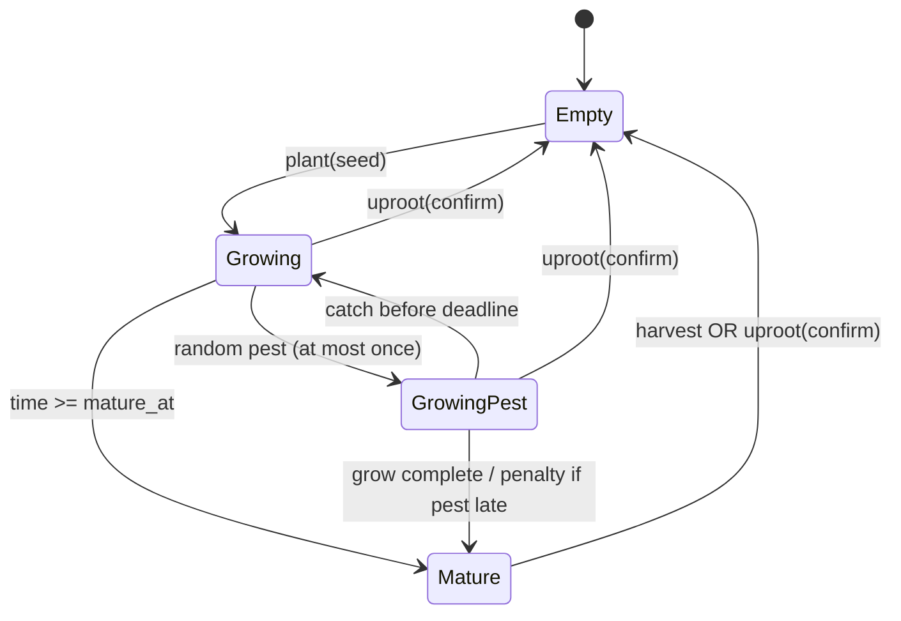
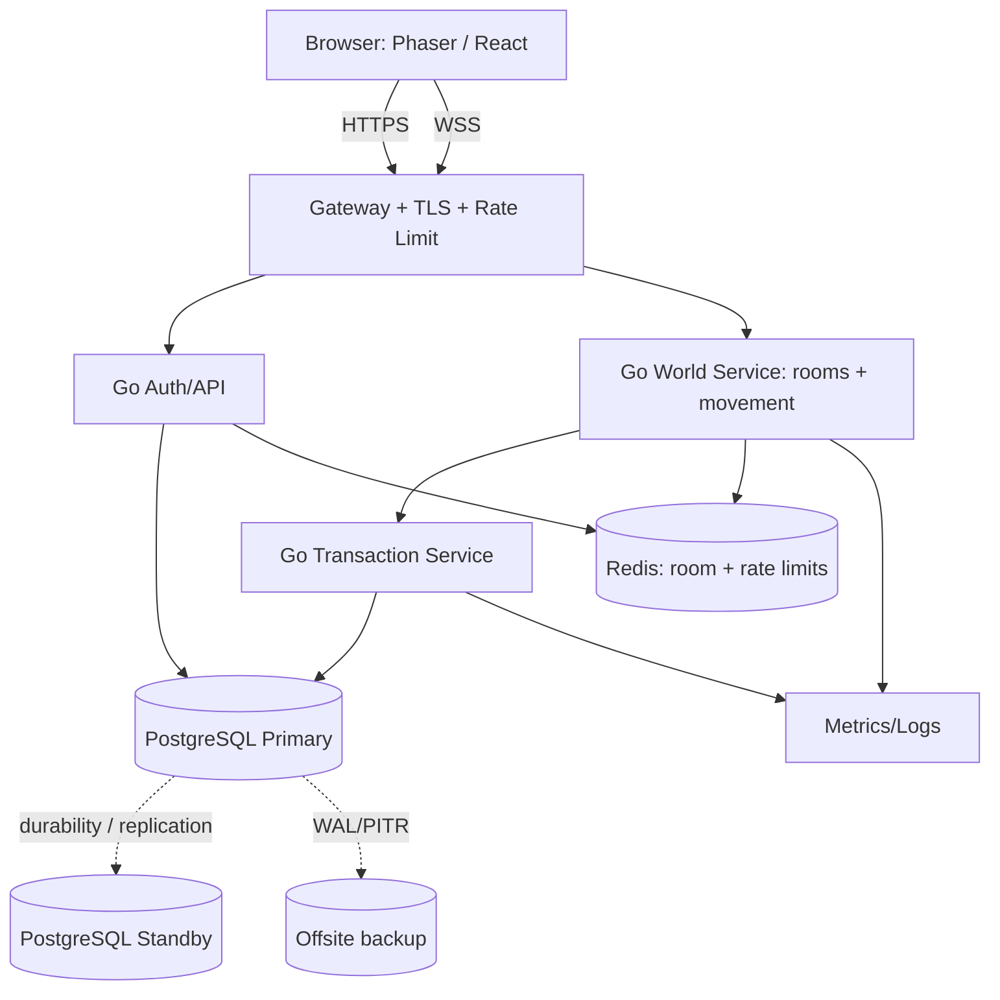
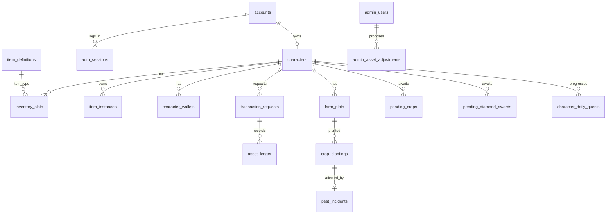

# PROJECT THANH — ĐẶC TẢ TỔNG HỢP CHO AI LẬP TRÌNH

**Phiên bản v2.0 — 21/10/2026**  
**Repository:** https://github.com/pqcuong99/Avatar.git  
**Mục tiêu:** Một tệp đọc liên tục chứa toàn bộ phần yêu cầu và kiến trúc bàn giao hiện hành. Các artefact SQL, OpenAPI, CSV, nguồn GDD 17 hệ thống và AI prompts vẫn nằm riêng trong gói ZIP.  
**Độ tin cậy:** `[CHỐT]` là quyết định chủ dự án, `[ĐỀ XUẤT]` là thiết kế kỹ thuật, `[CẦN CẤU HÌNH]`/`[CẦN ĐỐI CHIẾU]` chưa được tự ý chọn. Không dùng SQL draft cho production chưa review.

**Đang có:** demo Phaser/React đã chạy và hai Go `/healthz` đã được người dùng xác nhận. **Chưa xác nhận:** patch M1 đăng nhập đã merge/chạy. **Không đủ hạ tầng Open Beta:** một VPS Windows Server 2012 R2 thiếu WSL2/HA.

---


---

<!-- BEGIN docs/00_CONVENTIONS_AND_SOURCES.md -->

# 00 — Quy tắc nguồn, phạm vi và quản lý thay đổi

## 0.1 Nguồn được sử dụng

- `reference/DECISIONS_P0_001_183.md`: bảng tổng hợp 183 lựa chọn rõ ràng trong các phiên mới. Quyết định sau thay thế quyết định trước nếu có bằng chứng. Dữ liệu P0 là bản tóm tắt; không phải transcript nguyên văn.
- `reference/GDD_BASELINE_17_MODULES.md`: GDD chuẩn hóa 17 phân hệ, tổng hợp nguồn cũ và kiểm kê 1.198 câu thiết kế.
- `reference/LEGACY_DESIGN_AUDIT_1198.md`: bản kiểm kê tiến độ của 1.198 câu; **không có đủ nguyên văn câu hỏi và đáp án**, không được coi tất cả chi tiết đều có bằng chứng.
- `reference/M1_AUTH_PROTOTYPE_STATUS.md`, `reference/0001_auth_ACTUAL.sql`: trạng thái bản mã nguồn M1 v0.2 (đã tạo, chưa xác minh user chạy).
- Các xác nhận người dùng sau P0-183: clone Git về máy; Client demo chạy; Go Game Server + Transaction Service `/healthz` trả về đúng; người dùng muốn handoff chi tiết cho AI khác.

## 0.2 Chính sách ưu tiên

1. Chốt P0 có nội dung rõ và mới hơn > chốt cũ xung đột, có ghi lý do.
2. GDD baseline TH-xx chỉ áp dụng khi không bị P0 mới thay thế.
3. Trường hợp **không rõ là chốt hay chưa**: `CẦN ĐỐI CHIẾU`, không suy từ một chữ lựa chọn A/B/C thiếu ngữ cảnh.
4. Chi tiết data/API/DB trong gói là **đề xuất triển khai**. AI được viết code theo thiết kế này nếu không xung đột luật game, nhưng cần review schema trước production.

## 0.3 Những thay đổi phải ghi nhận

- P0-153–162 chốt MVP/Closed Beta/Open Beta; thay thế roadmap cũ 19/10 khi mâu thuẫn.
- P0-154: nạp tiền thật **sau MVP**; không triển khai webhook nhận tiền production ở Closed Beta.
- P0-156: sâu bệnh trong MVP, **nuôi chim sau MVP**.
- P0-157: chợ người chơi sau MVP.
- P0-160/177/178: Closed Beta được **đăng ký tự do, reset dữ liệu**; Open Beta không reset.
- P0-174 chọn WSL2, nhưng P0-175 xác minh VPS Windows 2012 R2 => không tương thích; P0-176 chuyển thành sử dụng VPS cũ tạm để kiểm thử, hạ tầng Linux/Docker khi nâng cấp.
- P0-180–182: Git monorepo `https://github.com/pqcuong99/Avatar.git`; Backend giao dịch viết Go.

## 0.4 Từ điển và ID

`account`: bản ghi đăng nhập; `character`: 1 nhân vật/account; `room`: bản thể hiện một bản đồ; `map`: cấu trúc Tiled; `slot`: ô túi; `stack`: lô vật phẩm đồng loại trong 1 ô; `pending`: tài sản chờ nhận; `crop planting`: lần trồng 1 hạt ở 1 ô; `NPC`: nhân vật hệ thống; `ledger`: sổ cái bất biến; `idempotency key`: khóa chống thực thi trùng; `CCU`: online đồng thời toàn hệ thống.

## 0.5 Tiêu chuẩn “đã chốt” vs “đã chạy được”

- **Thiết kế đã chốt:** có mã P0/TH rõ.
- **Đã code:** có commit mã nguồn thực; chưa chắc đã build/test.
- **Đã tích hợp:** chương trình chạy ở môi trường phát triển qua end-to-end test.
- **Đủ Closed Beta:** đã kiểm thử các nghiệp vụ đang mở, có backup/giới hạn rủi ro và môi trường chạy phù hợp.
- **Đủ Open Beta:** đáp ứng P0-139–152, 160–162, HA/khôi phục/giao dịch bảo toàn, test 300 CCU.

Không để AI khác gộp các trạng thái này thành “hoàn thành”.


<!-- END docs/00_CONVENTIONS_AND_SOURCES.md -->


---

<!-- BEGIN docs/01_PRODUCT_GDD_MVP.md -->

# 01 — Đặc tả sản phẩm MVP (Product Requirements + GDD)

## 1. Định vị và nền tảng [CHỐT]

- Game 2D xã hội/phong cách Avatar: giao tiếp và nông trại là trọng tâm. Chạy trên trình duyệt PC và mobile (ngang).
- PC: WASD/mũi tên, click để tự tìm đường. Mobile: joystick ảo, chạm điểm đến. Điều khiển tay hủy auto-path.
- Chủ dự án triển khai theo từng module, build tích hợp/test liên tục (P0-163); mục tiêu test 300 CCU cho Open Beta (P0-162).

## 2. Chức năng MVP bắt buộc [CHỐT]

| Mã | Phạm vi chính thức | Ngoài MVP |
|---|---|---|
| MVP-01 | Đăng ký/đăng nhập, 1 nhân vật/account, phiên duy nhất, tùy chọn 2FA người chơi, khôi phục tài khoản | Không bỏ các yêu cầu bảo mật chỉ vì bản test |
| MVP-02 | Bản đồ Tiled, phòng tự phân, nhiều người cùng phòng, đi lại và reconnect | Không cần UI chọn kênh |
| MVP-03 | Chat công cộng, tìm người, kết bạn, danh sách bạn, chat riêng | Bang hội chưa bắt buộc |
| MVP-04 | Túi đồ, chờ nhận, Xu, Kim Cương, NPC mua/bán | Chợ P2P sau MVP |
| MVP-05 | Nông trại 6 ô, 5 cây, sâu bệnh và bắt sâu thủ công | Nuôi chim, kho thức ăn chim sau MVP |
| MVP-06 | Thời trang cơ bản, NPC bán đồ, mặc/tháo, đồng bộ ngoại hình | Thời trang nâng cao sau MVP |
| MVP-07 | Nhiệm vụ cá nhân hằng ngày, có thưởng | Nhiệm vụ bang/hoạt động nâng cao chưa bắt buộc |
| MVP-08 | Admin RBAC/TOTP/audit, bảo trì, backup và kiểm thử | Không được bỏ an toàn tiền tệ |
| MVP-09 | Closed Beta tự đăng ký, có reset | Nạp tiền thật không hoạt động ở MVP |

## 3. Luồng người chơi end-to-end [CHỐT yêu cầu, ĐỀ XUẤT thứ tự UI]

**Luồng A — Người chơi mới**

1. Mở game từ desktop/mobile ngang; đăng ký username/password; email khôi phục là tùy chọn.
2. Đăng nhập; phiên mới làm phiên cũ mất quyền.
3. Nếu account chưa có character, tạo 1 nhân vật tên hợp lệ; không hỗ trợ xóa để tạo lại.
4. Server lưu nhân vật, khởi tạo 5.000 Xu, 0 KC, 10 ô túi, 6 ô đất.
5. Game Server phân vào phòng còn chỗ trên bản đồ công cộng; hiển thị nhân vật của những người cùng phòng.
6. Người chơi di chuyển/nhấp điểm, tương tác NPC/nông trại/chat/bạn bè.

**Luồng B — Nông trại → Xu**

1. Mua hạt giống ở NPC (giá hiệu lực theo bản bảo trì gần nhất).
2. Chọn ô đất trống, trồng hạt; ghi mốc thời gian và snapshot yield/duration.
3. Trong giai đoạn tăng trưởng có thể phát sinh sâu theo xác suất riêng cây; người chơi bắt thủ công miễn phí nếu còn hạn.
4. Cây đạt thời gian trưởng thành thì chờ mãi, không héo.
5. Thu hoạch: nếu không đủ chỗ cho **toàn lô của một cây**, toàn lô sang pending; nếu đủ, vào túi.
6. Nhận pending vào túi theo luật; bán nông sản có trong túi cho NPC để tăng Xu.
7. Mọi bước thay đổi tài sản phải nguyên tử, có audit ledger và chống replay.

**Luồng C — Xã hội**

1. Chat công cộng trong phòng, xem/nghiêng theo nhân vật cùng phòng.
2. Tìm người dùng, mở Profile, bấm Kết bạn; sau khi được chấp nhận quản lý danh sách bạn.
3. Bấm Chat riêng từ Profile; lưu lịch sử, seen/typing/privacy theo đặc tả TH-05/06.
4. Nếu hai bạn ở phòng khác nhau, Profile có `Đến cùng phòng` nếu phòng đích còn chỗ (P0-135).

**Luồng D — Vận hành Beta**

1. Admin cấu hình master-data, test staging và thông báo bảo trì.
2. Closed Beta cho tự đăng ký, không mã mời/whitelist; không nạp tiền thật; không cam kết giữ dữ liệu.
3. Trước kết thúc phải sao lưu, thông báo reset; xóa account và mọi dữ liệu người chơi, giữ admin/master-data.
4. Chỉ sau khi kiểm thử đạt mới chuyển môi trường an toàn hơn và mở Open Beta không reset.

## 4. Tính năng, quyền, bất biến

- Một account một character; đăng ký không cấp nhân vật tự động nếu người chơi chưa tạo.
- Không giao dịch giữa người chơi đối với hạt giống và nông sản; chúng **không thuộc phân loại khóa/không khóa**.
- NPC không đứng trùng nhau, có collider; nhân vật không đi xuyên NPC.
- Không thay đổi giá/NPC/bản tin đang hoạt động ngoài đợt bảo trì.
- Các thay đổi tài sản được thực hiện qua Transaction Service Go, không bởi Client.
- Hiển thị kết quả giao dịch chỉ sau khi backend cam kết và ghi đủ điều kiện bền vững.

## 5. Trạng thái phát hành

### Closed Beta [CHỐT]

Đăng ký tự do; VPS Windows Server 2012 R2 chỉ dùng nếu có runtime đủ tương thích và đã quản trị rủi ro. Chưa phải nền tảng đủ chuẩn Open Beta. Kết thúc xóa toàn bộ player-data, giữ Admin/config. Báo trước việc xóa.

### Open Beta [CHỐT]

Không reset dữ liệu hợp lệ; 300 CCU là điều kiện test tối thiểu, không phải room cap; cần dự phòng DB/Game Server, offsite backup/PITR, chống DDoS/rate-limit, kiểm thử an toàn tài sản, bảo mật và giao dịch. Không có ngày release cố định.

## 6. Không được tự suy diễn

- Chưa được chốt: tọa độ NPC, asset/sprites, quy tắc animation, FPS/tick chuẩn, danh sách map MVP cụ thể, giá bán nông sản, yield, ngưỡng/bảng thưởng nhiệm vụ, giá đồ thời trang.
- Hệ thống phong cách Avatar không có nghĩa tự sử dụng hình ảnh/nhân vật có bản quyền của trò chơi khác.
- Thiết kế TH-01–TH-17 cũ có nhiều nội dung sau MVP hoặc chưa kiểm chứng, giữ nguyên dưới `reference/`.


<!-- END docs/01_PRODUCT_GDD_MVP.md -->


---

<!-- BEGIN docs/02_GAMEPLAY_FARM_INVENTORY_ECONOMY.md -->

# 02 — Luật hệ thống tài sản, túi đồ, nông trại, sâu bệnh, NPC

**Ưu tiên cao:** Tài liệu này mô tả yêu cầu đã chốt, còn kiểu dữ liệu/mã trạng thái trong SQL/API là bản thiết kế đề xuất. Không đơn giản hóa những luật pending đặc biệt.

## 1. Khởi tạo và giới hạn

| Dữ liệu | Giá trị | Nguồn |
|---|---|---|
| Xu tạo nhân vật | 5.000 | P0-030 |
| Kim Cương tạo nhân vật | 0 | P0-031 |
| Trần ví Xu ban đầu | 999.999.999 | P0-035 |
| Trần Kim Cương | Admin cấu hình | P0-033 |
| Ô túi ban đầu | 10 | TH-02/P0 context |
| Mỗi lần nâng cấp túi | +5 ô | TH-02/P0 context |
| Ô đất ban đầu | 6 | P0-068 |
| Mỗi lần mở đất | +1 ô theo ID tăng | P0-069–071 |
| Stack nông sản, vật phẩm nâng cấp, sâu | 999 / ô | TH-02, P0-104 |
| Thời trang | 1 món / ô | TH-02 |

**[CẦN ĐỐI CHIẾU]** Quy tắc Xu vượt trần: GDD cũ ghi khả năng bị tiêu hủy không cảnh báo, chưa đầy đủ trường hợp đặc biệt. Không tự xây logic phá hủy Xu vượt cap khi chưa đối chiếu.

## 2. Túi và inventory

- Túi hiển thị ô có ID ổn định, sức chứa là số ô, không phải tổng số item. Stack tối đa theo loại.
- Item nông trại và hạt giống không giao dịch người chơi và không mang `bound/unbound`; fashion có thể thuộc bound/unbound và từng món riêng. Không tự cho rằng mọi item nâng cấp có thể P2P.
- Tăng ô túi +5, giá/giới hạn tăng do Admin quyết định, **chưa có con số**.
- Khi vật phẩm chưa nhận không thể đặt vào túi, phải giữ pending theo luật nguồn. Không áp dụng một chính sách pending chung cho mọi loại không được chốt.
- Các lệnh item đều có `request_id` chống trùng và được serialize theo nhân vật/kho tài sản.

### Kiểm tra có thể chứa batch N

**[ĐỀ XUẤT thuật toán]** `can_fit(item_type, quantity, inventory_snapshot)` tính tổng vị trí còn dư của stack cùng loại + ô trống tương thích. `stack_limit` không được vượt 999 cho farm/upgrade. Nếu `N > space`, tuyệt đối không tách một lần thu hoạch vào túi/pending; **toàn lô vào pending**.

## 3. Nông trại — danh mục cây [CHỐT]

| cây | ID đề xuất | Giá hạt tham chiếu Xu | Thời gian | Nội dung |
|---|---|---:|---:|---|
| Cà rốt | `carrot` | 100 | 30 phút | MVP |
| Khoai tây | `potato` | 250 | 60 phút | MVP |
| Cà chua | `tomato` | 500 | 120 phút | MVP |
| Ngô | `corn` | 750 | 180 phút | MVP |
| Bắp cải | `cabbage` | 1.000 | 240 phút | MVP |

Giá hạt tham chiếu, Admin **chốt lại trước mở Server**. **Yield, giá bán NPC và xác suất sâu của từng cây phải được Admin điền**; mặc định để trống/không thể mua hoặc trồng khi chưa cấu hình. Các cây V1: dâu tây, bí ngô, dưa hấu, ớt, khoai lang, chưa có thông số — sau MVP.

### Trồng một ô

**Tiền điều kiện**: chủ có plot đã mở, plot trống, còn ≥1 hạt; loại cây có config active.  
**Giao dịch**: khóa plot + inventory, trừ 1 hạt, tạo planting (`planted_at`, `matures_at`, `base_yield_snapshot`, `growth_seconds_snapshot`, `config_version`); commit cùng transaction + audit.  
**Hậu điều kiện**: plot có cây; tên/growth snapshot không bị sửa bởi config bảo trì sau đó.  
**Lỗi**: thiếu hạt, plot đã có cây, plot bị khóa, cấu hình chưa hợp lệ, trùng `request_id` → từ chối không mất item.

### Trồng tất cả

- Chọn **một loại hạt**, yêu cầu xác nhận hiển thị loại/số hạt.
- Duyệt ô trống theo plot ID tăng dần, trồng tới khi hết hạt hoặc hết ô.
- Thứ tự commit, kết quả cụ thể cần hiển thị. **[ĐỀ XUẤT]** thao tác batch nguyên tử cùng `request_id` để chống nửa chừng.
- Trồng một ô không cần hộp xác nhận.

### Cây đủ thời gian và nhổ cây

- Cây trưởng thành **không héo**, không bị tự xóa dù Offline hoặc bảo trì.
- Nhổ cây khi chưa chín hoặc đã chín đều **mất toàn bộ cây/hạt/sản lượng tiềm năng**, không hoàn Xu/nông sản.
- Mọi lần nhổ cây đơn đều xác nhận; nhổ tất cả bao gồm cả cây non và cây chín, có xác nhận.
- Không có tưới nước/phân bón.

### Thu hoạch một ô

- Chỉ cây đủ `matures_at` mới được thu.
- Một planting chỉ được thu hoạch **một lần**; thu xong cây biến mất, plot trống.
- `yield_final = base_yield_snapshot - floor(base_yield_snapshot * pest_penalty_percent/100)` nếu sâu quá hạn, còn không `yield_final = base_yield_snapshot`.
- Nếu `inventory_can_fit(yield_final)`: cấp toàn bộ lô vào túi; nếu không: cấp **toàn bộ lô** vào `pending_crop`.
- Không tự xóa tài sản dù túi đầy; hoàn tất commit atomically.
- Nút Thu hoạch tất cả: **chỉ cây đã chín**, không xác nhận; duyệt plots theo ID tăng, cây không đủ chỗ chuyển toàn lô pending và tiếp tục ô sau.

## 4. Pending nông sản — luật đặc biệt P0-075–085

1. Chỉ nông sản đã thu không đủ chỗ mới ở pending; không được bán NPC khi đang pending.
2. **Không tự động chuyển** vào túi khi có ô trống; người chơi bấm nhận thủ công.
3. Gộp pending **cùng loại nông sản** thành một dòng (`crop_id`, `quantity`), giữ thời điểm pending sớm nhất để sắp FIFO.
4. Mặc định muốn nhận phải chứa **đủ toàn bộ dòng**. Nếu không đủ → không nhận, không thay đổi tồn.
5. Nút **Nhận tất cả** xử lý các dòng theo FIFO, **dừng ở dòng đầu tiên không nhận nguyên vẹn**.
6. Ngoại lệ P0-083: nếu **số lượng dòng gộp lớn hơn sức chứa túi tối đa có thể có** (không chỉ số chỗ trống tức thời), được nhận từng phần. Chọn tối đa số đang chứa được, trừ vào pending. Nút Nhận tất cả gặp ngoại lệ này cũng nhận tối đa rồi dừng.
7. Nếu không thể chứa con nào ở ngoại lệ → giữ nguyên, dừng. Không ghi nhận thành công giả.
8. `pending` hợp nhất phải khóa theo `character_id,crop_id` trong transaction để tránh lost update khi 2 lần thu đồng thời.

**[CẦN CẤU HÌNH]** “sức chứa túi tối đa có thể có” khi Admin chưa chốt giới hạn nâng cấp túi => kỹ thuật phải có hàm config, không gán cứng 10, 999 hoặc số tùy ý. Nếu giới hạn túi không xác định, phải làm rõ trước khi kích hoạt ngoại lệ nhận một phần.

## 5. Sâu bệnh — P0-096–102, P0-156

- Mỗi lần trồng có **tối đa 1 sự kiện sâu**; xác suất sâu khác nhau theo loại cây (Admin config).
- Sự kiện có thể phát sinh ở thời điểm ngẫu nhiên trong **70% đầu** thời gian trồng; hạn bắt sâu là **30% toàn bộ thời gian tăng trưởng** kể từ lúc sâu xuất hiện (không phải 30% phần thời gian còn lại).
- Bắt sâu miễn phí qua nút `Bắt sâu`; được 1 item sâu đưa vào túi theo luật đã chốt, tối đa 999/ô. **[CẦN ĐỐI CHIẾU]** nếu túi không đủ chỗ nhận sâu, cơ chế pending sâu chưa được chọn rõ; không tự xóa hay cấp trùng.
- Khi hết hạn mà không bị bắt, tỷ lệ phạt chọn là một **số nguyên trong {5,6,7,8,9,10}**; trừ `floor(base_yield_snapshot × pct/100)`; `floor=0` chấp nhận.
- Phải lưu **đã phát sinh hay không**, `spawn_at`, `deadline_at`, `penalty_pct`, `caught_at` (nếu có). Không gieo random lại sau reconnect/restore; phải có cơ chế deterministic persist/scheduled processing.
- Chim tự bắt sâu/kho thức ăn **sau MVP**, không cài vào M4; tham chiếu P0-103–133 để mở rộng.

## 6. Kim Cương pending và trần ví

- Giới hạn Kim Cương do Admin cấu hình; nạp tiền thật chưa triển khai MVP.
- Phần **Kim Cương thưởng** vượt cap đưa vào hàng chờ, tách từng entry theo nguồn thưởng; không hết hạn.
- Nhận thủ công, Nhận tất cả theo thời gian FIFO từ cũ nhất; nhận bao nhiêu tới khi đủ chỗ, không tạo quá trần. **[CẦN ĐỐI CHIẾU]** nếu entry lớn hơn chỗ trống, phương án nhận một phần áp dụng cho KC chưa được chốt tương đương pending crop; cần review trước khi code.
- Không gộp pending KC cùng nguồn giống pending nông sản.

## 7. Giao dịch NPC và bảo trì

- NPC collider cố định, không chồng NPC; bản đồ Tiled cùng version trên Client/Go Server.
- NPC nhiều menu: **menu dọc bên trái / cửa sổ bán-hội thoại bên phải**. Click menu đổi nội dung bên phải, **không mở lại cửa sổ**.
- Giá NPC và cấu hình chỉ áp dụng sau đợt bảo trì; `effective_version` do Server quyết định. Đơn đã commit không bị thay đổi bởi bản giá mới.
- Bán nông sản: dùng **giá mới nhất có hiệu lực** tại thời điểm giao dịch, kể cả cây trồng từ cấu hình cũ. Chỉ bán nông sản trong túi.
- Mua: phải có Xu/KC đủ, túi đủ chỗ theo item rules; không cho Client báo giá tùy ý.
- Giao dịch thật luôn Server-authoritative; ghi số dư, item, ledger và idempotency trong 1 PostgreSQL transaction.

## 8. Dữ liệu gốc vs master data chưa chốt

- `master-data/crop_catalog.csv`: có 5 cây, giá tham chiếu và thời gian đã chốt; cột yield, sell, pest **trống có chủ ý**.
- `master-data/economy_initial.csv`: tham số tiền và ô đã chốt, thiếu config giao dịch nâng cấp.
- Không thay số trống bằng `0` hay giá demo một cách im lặng; dùng trạng thái `DRAFT_INCOMPLETE` để block phát hành.


<!-- END docs/02_GAMEPLAY_FARM_INVENTORY_ECONOMY.md -->


---

<!-- BEGIN docs/03_SOCIAL_CHAT_CHARACTER_ADMIN.md -->

# 03 — Account, Character, Chat, Friends, Fashion, Daily Quests, Admin

## 1. Account và đăng nhập [CHỐT]

- Đăng ký tên tài khoản và mật khẩu; email khôi phục có thể để trống. Nếu đã liên kết email và xác minh, reset qua mã/link một lần **hạn 10 phút**, reset mật khẩu phải revoke các session cũ.
- Không có email: hỗ trợ Admin theo chứng cứ sở hữu, đánh giá từng trường hợp; kênh xác minh có thể email xác thực, Zalo/Discord hoặc ticket an toàn do Admin chọn.
- Login mới vô hiệu phiên cũ của cùng account; logout/reconnect kiểm tra lại tại server. Có một nhân vật/account, không có chức năng xóa/tạo lại.
- Anti-bruteforce đa tầng: hạn tốc độ theo account/IP/dấu hiệu thiết bị, tăng delay/CAPTCHA khi rủi ro; không tự khóa vĩnh viễn do nhập sai.
- Người chơi có thể bật 2FA TOTP và recovery codes, mặc định không ép buộc. Đổi/tắt 2FA phải xác minh quyền sở hữu.

**[ĐỀ XUẤT]** Không dùng tài khoản login name làm character display name. Tách bảng character, username validation riêng; M1 v0.2 chỉ làm username ASCII tạm.

## 2. Đặt tên Character [CHỐT P0-018–029]

- Chính xác 1 character/account; không xóa để tạo lại.
- Tên **duy nhất toàn game**, so sánh **không phân biệt hoa/thường**, **vẫn phân biệt dấu tiếng Việt**.
- Độ dài 3–16 **Unicode grapheme clusters** (ký tự nhìn thấy), không dùng số byte hay rune để quyết định.
- Cho phép chữ tiếng Việt, chữ/số, dấu cách, và các ký tự `_`, `-`, `.`, `★`, `♥`, `☆`, `♡`. Tập/điều kiện khoảng trắng liên tiếp ở đầu/cuối **chưa chốt** — review nếu muốn chuẩn hóa.
- Đổi tên bằng một Thẻ Đổi tên khi thành công, không cooldown, không giới hạn số lần. Card source Admin cấu hình; rename thất bại không tiêu thẻ.
- **[ĐỀ XUẤT]** `normalized_key=NFC + Unicode Default Case Folding` ứng dụng tính, khóa UNIQUE database; không strip dấu tiếng Việt; lưu raw display NFC. Test cả chữ dạng composed/decomposed.

## 3. Hiện diện, map, friends [CHỐT]

- Tự chia room theo cap Admin; đầy tự tạo room; click `Đến cùng phòng` từ Profile bạn bè nếu room bạn còn chỗ, còn đầy từ chối rõ; không có chọn kênh thủ công.
- Disconnected trong 30 giây: đứng yên trong room, không icon offline, vẫn chiếm chỗ; reconnect trong grace về đúng room/vị trí. Sau 30 giây giải phóng; login sau dùng vị trí Server lưu và tự phân room.
- Friends: tối đa **100 người** từ GDD baseline TH-07; người chơi tìm thủ công, nhấn kết bạn; Profile hỗ trợ xem người và Chat riêng/Kết bạn.
- Các trạng thái lời mời bạn và điều kiện hủy/đồng thời cần tuân baseline nếu có; nếu không có chi tiết phải có nhãn đề xuất.

## 4. Public chat và Private chat

### Public chat [CHỐT MVP]

- Tin công cộng tới thành viên **cùng room**, không tự phát toàn server.
- Tin nhắn gửi thành công khi được server xác thực và ghi/đẩy đúng; rate-limit và moderation để tránh spam.
- **[CẦN CẤU HÌNH]** ký tự tối đa, rate limit/từ cấm, thời hạn giữ tin công cộng, emoji/file chưa chốt.

### Private chat [CHỐT từ TH-05/TH-06]

- Người chơi chọn người, nhấn `Chat riêng`; hiển thị đúng hội thoại.
- Lưu tin từng tin **30 ngày kể từ lúc gửi thành công**. Chỉ những tin chưa hết hạn được trả về; xóa/ẩn có quy trình riêng, không hồi sinh sau unblock.
- Tải lần đầu **50 tin**; khi cuộn gần đầu lấy thêm **20 tin cũ**, giữ đúng vị trí scroll, phân trang theo cursor để tránh lặp.
- `seen/read` gắn với tin thực sự đi vào **viewport**; không tự đánh dấu đọc toàn bộ khi mở hội thoại. Có typing indicator, seen, draft trong phiên.
- Block chat riêng **một chiều**, không công khai cho người bị chặn; khi họ gửi không thành công hiện lỗi chung, không lộ nguyên nhân. Unblock không tự chat/kết bạn/khôi phục message hết hạn.
- Danh sách chặn **không giới hạn**, mới chặn trước, tìm tên không phân biệt hoa/thường/**dấu** hoặc ID đầy đủ; trang đầu 50 rồi thêm 20.
- GDD nhắc **4 đường bỏ chặn** nhưng chưa có tên/hành vi chính xác của tất cả; **[CẦN ĐỐI CHIẾU]** trước thiết kế nút UI chi tiết.
- Đóng màn danh sách chặn có thể hủy load dữ liệu chưa xong, **không hủy lệnh unblock** server đã nhận.

## 5. Fashion [CHỐT MVP phạm vi cơ bản]

- NPC bán một số đồ trang phục/phụ kiện; người chơi mua, sở hữu trong túi, mặc, tháo, thay món.
- Mỗi fashion item là **một instance** (không stack), nhân vật khác trong room nhìn thấy trang phục đang mặc.
- Bound/unbound và hạn dùng theo rule từng item, không đồng nhất với seed/crop.
- **[CẦN CẤU HÌNH]** item catalog MVP, ảnh/tile sprite, slot trang bị, giá, layer hiển thị/priority, collider/animation.
- **[ĐỀ XUẤT]** entity `fashion_item_instance`, `equipment_slot`, sự kiện `appearance.changed` sau commit để sync room.

## 6. Daily personal quests [CHỐT MVP]

- Nhiệm vụ ngày cơ bản theo hoạt động có trong MVP (trồng, thu, bán NPC, chat và hoạt động tương thích).
- Tiến độ được tính bởi sự kiện server, tránh client giả report; thưởng 1 lần khi đạt; tránh trùng qua idempotency.
- **[CẦN CẤU HÌNH]** số nhiệm vụ/ngày, danh sách, điều kiện, thưởng, thời điểm reset/ngày theo timezone; không tự dùng chính sách 10 nhiệm vụ/5 nhận của nhiệm vụ **bang hội** cho cá nhân.
- **[ĐỀ XUẤT]** khóa unique `(character_id, quest_id, reset_date)`, earned/claimed_at; reset an toàn khi qua ngày.

## 7. Admin & các thao tác nhạy cảm [CHỐT]

| Vai trò | Phạm vi ví dụ | Lưu ý |
|---|---|---|
| Super Admin | Quản lý quyền và hệ thống | Không tự approve yêu cầu tài sản của mình |
| Game Admin | NPC, catalog, bảo trì, nội dung, xử lý vi phạm | Chỉ quyền được cấp |
| Hỗ trợ | Xem/tra cứu, hỗ trợ người chơi | Không mặc định có quyền sửa số dư |
| Tài chính | Đơn nạp/đối soát (sau MVP) | Không tự động có quyền mọi tài sản |

- RBAC đến từng permission; Admin **bắt buộc 2FA TOTP**, có recovery code một lần.
- Mọi thay đổi thủ công Xu, KC, item: `proposer` tạo yêu cầu, Admin khác có quyền `approver` quyết định. **Không cho cùng một tài khoản tạo và duyệt**, kể cả Super Admin. Sau approve mới commit ledger; ghi lý do, before/after và audit.
- Các giao dịch gameplay tự động bình thường không yêu cầu hai Admin duyệt.
- Bản tin, giá, NPC/config thay đổi chỉ phát hành sau bảo trì có thông báo, staging/test/backup/QA, rollback theo nguyên tắc không làm mất giao dịch.
- Bị ban hiển thị lý do do Admin nhập theo baseline cũ; **[CẦN ĐỐI CHIẾU]** các loại/độ dài/thời hạn ban nếu muốn triển khai đầy đủ.

## 8. Sau MVP — không triển khai trong các module MVP

- Nuôi chim bắt sâu: chim non 12h + phải đủ worm food; trưởng thành sống 720h; 4 captures/rolling 60m/bird; ưu tiên deadline sớm/plot thấp; ăn sâu ngay; giao dịch cho NPC. Chi tiết P0-103–133.
- Chợ player: vật phẩm vĩnh viễn đủ điều kiện, không khóa, mua bán theo baseline; nông sản/hạt giống không thể lên chợ.
- Nạp tiền thật QR: 1.000 VND/KC, đơn QR unique, 15 phút, webhook và đối soát, chỉ khi mở module thanh toán sau MVP.
- Bang hội/leaderboard/câu cá/mini-games vẫn có baseline 17 hệ; **chưa chốt tất cả thời điểm phát hành**.


<!-- END docs/03_SOCIAL_CHAT_CHARACTER_ADMIN.md -->


---

<!-- BEGIN docs/04_UI_UX_SCREENS.md -->

# 04 — Màn hình, trạng thái UI/UX và luồng thao tác

**Phân biệt:** Các luồng/chức năng đánh `[CHỐT]`, wireframe/chi tiết màu, kích thước và thứ tự UI là `[ĐỀ XUẤT]`. Không có tài nguyên đồ họa chính thức trong nguồn. AI khác phải tạo asset gốc hoặc xin asset được phép sử dụng.

## 1. Danh mục màn hình MVP

| ID | Màn hình | Nhiệm vụ | Trạng thái bắt buộc |
|---|---|---|---|
| UI-01 | Đăng ký | username/password, email tùy chọn | nhập, validate, chờ, thành công, trùng, rate limit, lỗi mạng |
| UI-02 | Đăng nhập | username/password, TOTP tùy chọn | loading, sai thông tin, bị ban, 2FA, session expired, retry |
| UI-03 | Tạo nhân vật | tên 3–16 grapheme, Unicode | available, invalid chars, duplicate, server reject, complete |
| UI-04 | Bản đồ chính | Phaser canvas + React HUD | connecting, connected, reconnecting, maintenance, server-down |
| UI-05 | Menu người chơi | Profile, Friends, Chat riêng | loading, online/offline, blocked, permission |
| UI-06 | Chat công cộng | tin trong phòng | gửi/nhận, pending, success, failed, spam limit, scroll |
| UI-07 | Chat riêng | lịch sử 50+20, seen/typing | loading/cursor, viewport read, block, expired, network failure |
| UI-08 | NPC cửa hàng | menu **trái**, nội dung **phải** | loading price-version, buy/sell result, bag full, insufficient funds |
| UI-09 | Túi đồ | 10 ô ban đầu, stack 999, 1 fashion/ô | item select, empty, full, upgrade, reject |
| UI-10 | Hàng chờ nông sản | merged crop pending | FIFO, claim, claim all, insufficient space, exceptional partial |
| UI-11 | Farm | 6 plot ban đầu, trồng/thu/nhổ/sâu | empty/growing/pest/mature, confirm uproot/Plant All |
| UI-12 | Thời trang | mua/mặc/tháo | equipped, not owned, conflict, room appearance sync |
| UI-13 | Nhiệm vụ ngày | tiến độ và claim | available, in progress, complete, claimed, day reset |
| UI-14 | Admin | login TOTP, RBAC, nội dung/điều chỉnh | forbidden, pending approval, approved, reject, audit |

## 2. Bố cục bản đồ [ĐỀ XUẤT]

- Canvas Phaser chiếm không gian trung tâm, camera theo nhân vật; React overlay chứa thông tin chính, nút mở cửa sổ.
- PC: WASD/arrows/click-to-path; mobile: **ngang**, joystick trái và chạm điểm đến; UI touch targets đủ lớn, không cản di chuyển.
- Bản đồ/phòng nhận `map_version`/`room_id`; Client không được tự gửi tọa độ cuối như “sự thật”.
- Không hiển thị icon mạng lên đầu nhân vật đang grace 30s (P0-009); có thể thông báo reconnect cho chính chủ ở HUD (đề xuất).

## 3. NPC — menu trái, nội dung phải [CHỐT]

```text
+---------------------------------------------------------+
| NPC [Tên]                          [Đóng]                |
+-----------------+---------------------------------------+
| Mua             | Danh sách/giá/vật phẩm theo tab       |
| Bán             | [Lọc] [Item] [Qty] [Giá] [Xác nhận]  |
| Hội thoại       |                                       |
| Các tab cấu hình| Trạng thái gửi và kết quả giao dịch    |
+-----------------+---------------------------------------+
```

- Click đổi tab **không đóng/mở lại** cửa sổ; menu trái và pane phải giữ nguyên trên mobile (tự co/scroll phù hợp).
- Giá có hiệu lực theo bản config bảo trì; nếu giá phiên Client lỗi thời, backend reject và yêu cầu tải lại; không âm thầm áp giá mới giữa 1 giao dịch đã được chốt.

## 4. Farm — state machine



- Khi người chơi offline hoặc bảo trì, trạng thái tính từ server timestamp; không dùng local timer làm nguồn thật.
- `Trồng tất cả`: cần confirm loại/số hạt. `Thu hoạch tất cả`: **không** confirm. `Nhổ tất cả`: confirm dù cây chín hay chưa.
- Đánh dấu plot theo ID để người chơi hiểu thứ tự thao tác batch.

## 5. Pending UI — nguyên tắc ưu tiên

- Hàng chờ nông sản: hiển thị cây, tổng số, thời gian sớm nhất, `Nhận`, `Nhận tất cả`. Nếu dòng không vừa: từ chối, không tự lấy một phần trừ ngoại lệ P0-083.
- Hàng chờ Kim Cương: hiển thị từng source/entry và FIFO, không gộp như nông sản.
- Luôn làm rõ `Đang xử lý` / `Thành công` / `Thất bại`; không hiển thị thành công ngay khi click trước ack từ Server.

## 6. Chat UI

- Chat công cộng theo phòng; cuộn/ẩn chat không làm mất dữ liệu server.
- Chat riêng: 50 tin đầu (cửa sổ mới nhất), khi cuộn gần đầu fetch 20 tin cũ và giữ vị trí; `seen` chỉ cho các tin thực sự hiện trong viewport.
- `Blocked`: thông báo gửi thất bại kiểu chung, không nêu “người kia đã chặn bạn”.
- Tìm block list theo tên bỏ dấu/hoa thường hoặc chính xác ID; 50 đầu +20 sau; mới chặn trước.

## 7. Accessibility / responsiveness [ĐỀ XUẤT]

- Font Unicode Việt, wrap text, form label rõ, keyboard focus, thông báo không phụ thuộc duy nhất màu.
- Desktop có hotkeys; mobile landscape duy trì menu trái NPC, dùng scroll trong khung thay vì đổi vị trí.
- Đoạn mạng yếu: tránh spinner vĩnh viễn, có retry và giữ `request_id`, không tự thao tác lặp gây nhân đôi.

## 8. Asset chưa có

Chưa có spritesheet nhân vật, tilesets, map Tiled sản phẩm, hình NPC, bản vẽ thời trang, animation, âm thanh, biểu tượng UI, typography, license. Chưa thể coi UI Ready-to-Ship. AI tạo asset phải cung cấp manifest `asset_id`, nguồn, quyền sử dụng, atlas frame, anchor, collider và màn kiểm duyệt chủ dự án.


<!-- END docs/04_UI_UX_SCREENS.md -->


---

<!-- BEGIN docs/05_TECHNICAL_ARCHITECTURE.md -->

# 05 — Kiến trúc hệ thống, module, đồng bộ thời gian thực

## 1. Stack cố định [CHỐT]

- Client: **TypeScript + Phaser 2D + React**; web PC/mobile ngang.
- Game Server: **Go**, quản lý các phòng, chuyển động, người chơi trực tuyến, tương tác world.
- Transaction Service: **Go**, kiểm soát asset/ Xu/KC/ farm, atomic DB commits.
- PostgreSQL: account, character, inventory, economy, farm, quest, ledger, chat persistent.
- Redis: caching, rate-limit, presence/room registry/coordination; **không là canonical Xu/KC/item**.
- Tiled Map Editor: dữ liệu map JSON có collision sử dụng tương ứng trên Phaser/Go.
- Real-time: **WSS** với JSON cho message tần suất thấp, binary cho move/state snapshots.
- Monorepo GitHub `pqcuong99/Avatar`.

## 2. Sơ đồ components



**[ĐỀ XUẤT]** Có thể ban đầu dùng một Go codebase với package/service boundaries, sau đó tách process khi đạt đường găng. **[CHỐT]** Game Server không được sửa tài sản trực tiếp, trách nhiệm transaction tách riêng.

## 3. Go packages đề xuất

```text
game-server/
  cmd/world-server/
  internal/authn/          # verify cookie/token, version session
  internal/rooms/          # room allocation / transfer
  internal/movement/       # authoritative movement
  internal/mapdata/        # Tiled collisions + map version
  internal/realtime/       # JSON/binary codec + WS
  internal/presence/       # reconnect grace 30s
  internal/chat/           # public room chat gateway
transaction-service/
  cmd/transaction-service/
  internal/wallet/         # Xu, KC + ceilings
  internal/ledger/         # immutable transaction journal
  internal/inventory/      # slots and item instances
  internal/farm/           # plots, crops, pest, pending
  internal/npc/            # published price catalogs
  internal/quests/         # idempotent reward claim
  internal/idempotency/    # retry safe
  internal/storage/        # sql transaction and locks
client/src/
  game/                    # Phaser scenes + collision/pathing
  features/auth, farm, inventory, npc, chat, friends, fashion, quests
  network/                 # HTTP + WSS client
shared/                    # schemas generated from contracts, not Go structs directly
```

## 4. Movement [CHỐT behavior, ĐỀ XUẤT implementation]

- Local prediction from WASD/joystick or client A* pathfinding when click/touch. Manual override aborts path.
- Client gửi **input/direction/sequence**, không cập nhật canonical x/y theo ý mình.
- Go World Server kiểm tra speed limit, collision, map version, input timeline, room membership; vượt hợp lệ → reject/snap correction + log; nghi vấn lặp lại → Admin review, không tự ban.
- Người khác nhìn bằng interpolation; Client self-correct (reconciliation).
- Chỉ broadcast đến người trong room liên quan (interest management).
- **[CẦN TEST]** tick/snapshot update interval, delta encoding, bit packing, max payload, map scale; không chốt 20 Hz/30 Hz tùy tiện.

## 5. Rooms/reconnect/failover

- Room = (map_id, room_instance_id), `cap` do Admin cấu hình. Khi đầy tạo room khác, không UI chọn kênh.
- Profile người bạn -> `join-friend-room`: kiểm tra friendship + target session + capacity + map permission; chuyển atomically; nếu đầy báo lỗi, không vượt cap.
- Mất mạng 0–30s: vẫn chiếm 1 suất và hiện nhân vật đứng yên, session reconnect với token đủ điều kiện lấy lại phòng/vị trí.
- Quá 30s: giải phóng suất; reconnect muộn từ vị trí hợp lệ server persist và tự phân phòng.
- Một Game Server chết: cô lập instance, dùng state bền vững phục hồi phòng trên instance sống nếu có; không suy rằng RAM cũ có thể cứu được sau crash.
- **[CHỐT yêu cầu HA]** một server chết không kéo sập toàn game; PostgreSQL có dự phòng tự failover chỉ với leader hợp lệ, đồng bộ ghi an toàn. **[CHƯA TRIỂN KHAI]** vì hiện tại chỉ có 1 VPS cũ.

## 6. Transaction execution — canonical

```text
Client action(req_id, target, proposed_qty)
  -> Game Server verifies proximity/rights, derives server-side command
  -> Transaction Service (Go), verifies authenticated account/character
  -> BEGIN PostgreSQL transaction
  -> INSERT idempotency key (unique); if existing read prior result
  -> Lock wallet/inventory/farm/plot rows in consistent order
  -> Read active config version; validate prices, capacity, ownership
  -> Write all state changes; write immutable ledger entries + outbox
  -> COMMIT safely (per database durability policy)
  -> Return result and publish state.changed only after commit
```

- HTTP timeout/reconnect cannot imply rollback or success. If unknown outcome: query `request_id` outcome; do not send duplicate with new id.
- Monetary payment webhook idempotency is separate post-MVP, never generated from Client balance claims.
- For P0-150, if PostgreSQL cannot acknowledge required durable replica, **stop asset mutation** rather than tell players success.

## 7. Time and RNG

- `now()` ở Server (time stamps UTC). Plant `matures_at = planted_at + growth_seconds_snapshot`; login/restart reconstruct from DB timestamp.
- Random pest occurrence and penalty percent generate **once**, persist plan/event in durable storage; no re-roll on refresh.
- No per-crop in-memory timer as sole source of truth. For scheduled jobs, database state + idempotent worker can materialize overdue events (technical extension).

## 8. Docker/Local/production assumptions

- Local Windows developer Docker Desktop/WSL2 hiện đã chạy được demo UI/Go health according to user. Compose local + migrations from M1 patch need verification before use for data-bearing development.
- VPS Windows Server 2012 R2 **không thể dùng WSL2**; không giả vờ Docker Compose Linux chạy trực tiếp. Muốn Closed Beta ở máy cũ phải khảo sát runtime khả thi và rủi ro, hoặc có phương án host khác. Không khuyến nghị chạy hệ thống nhạy cảm trên OS hết hỗ trợ.
- Production/Open Beta: nhiều máy chủ/HA PostgreSQL/backup ngoài host, reverse proxy HTTPS/WSS, monitoring, graceful deploy + maintenance.


<!-- END docs/05_TECHNICAL_ARCHITECTURE.md -->


---

<!-- BEGIN docs/06_DATABASE_SPEC.md -->

# 06 — Đặc tả cơ sở dữ liệu PostgreSQL

> **Bản schema đề xuất, không phải luật game đã được chủ dự án phê duyệt.** File SQL: `db/draft/0002_domain_PROPOSAL.sql`. File tham chiếu migration M1 thực tế: `reference/0001_auth_ACTUAL.sql`. Cần giữ/di chuyển tương thích với các bảng đã tồn tại; KHÔNG chạy draft bằng auto-migrate.

## 1. Nguyên tắc chuẩn hóa

- Primary keys UUID cho entity, key tự nhiên unique cho `item_code`, `crop_code`, `npc_code`, `quest_code`.
- `timestamptz` trong UTC; thời điểm ngày/giờ hiển thị được convert theo múi giờ; timezone reset nhiệm vụ chưa chốt.
- Số tiền tệ BIGINT nguyên, không float, không `REAL`.
- `config_version` bất biến sau publish; NPC price và crop config chỉ có hiệu lực sau bảo trì.
- Unique/cascade phải phản ánh 1 nhân vật/account và reset Beta.
- Ledger append-only bằng quyền DB/ứng dụng; chỉ người vận hành đặc quyền được thực thi lệnh Beta reset đã review.
- Trạng thái room/presence/position realtime quản lý Go+Redis; DB lưu vị trí hợp lệ cuối, không ghi mỗi frame.

## 2. Danh sách bảng theo domain

| Domain | Bảng đề xuất | Mục tiêu |
|---|---|---|
| Auth đã có M1 | `accounts`, `auth_sessions` | User, password_hash, login_generation, hashed token |
| Character | `characters`, `character_renames` | Một character/account, tên Unicode unique, lưu map/vị trí |
| Config | `game_config_versions`, `game_config_values` | Nội dung có version và publish qua bảo trì |
| Item/Inventory | `item_definitions`, `item_instances`, `inventory_slots`, `character_equipment` | Item catalog, fashion riêng instance, slot và trang bị |
| Money/Transactions | `character_wallets`, `transaction_requests`, `asset_ledger`, `outbox_events` | Balances, idempotency, sổ cái và phát event sau commit |
| Pending diamond | `pending_diamond_awards` | KC thưởng vượt cap theo từng nguồn, FIFO, no expiry |
| Farm | `crop_definitions`, `crop_config_versions`, `farm_plots`, `crop_plantings`, `pest_incidents`, `pending_crops` | Cây, plot, snapshot, sâu, crop pending gộp |
| NPC | `npc_definitions`, `npc_offers` | NPC vị trí và bảng giá versioned |
| Social | `friend_requests`, `friendships`, `private_chat_blocks`, `private_chat_messages`, `private_chat_seen`, `public_chat_messages` | Bạn bè, block, PM 30d, seen viewport, chat phòng |
| Quests | `quest_definitions`, `character_daily_quests` | Nhiệm vụ server-side, per-day claim once |
| Admin | `admin_users`, `admin_roles`, `admin_permissions`, `admin_user_roles`, `admin_role_permissions`, `admin_asset_adjustments`, `admin_audit_logs` | Tách player, 2FA, RBAC, dual approval, audit |

**Sau MVP:** các bảng chim, kho sâu, chợ P2P, payment webhook được lập migration mới, không lẫn vào MVP.

## 3. ERD logic



## 4. Account/Character & Unicode

- M1 `accounts`: đã có `username_key` ASCII tạm và `login_generation`. Không đổi trực tiếp tên bảng khi gắn patch.
- `characters.account_id UNIQUE` tạo bất biến 1 account đúng một nhân vật tối đa; frontend không được có thao tác delete/recreate.
- `characters.display_name_key UNIQUE`: tính Unicode normalization + casefold **không strip dấu**. DB không tự dùng `lower` collation để bảo đảm Unicode.
- Client xác minh nhanh, Server chuẩn hóa lại; kiểm tra grapheme bằng thư viện đúng chuẩn; khóa UNIQUE cuối cùng chặn cạnh tranh.
- Khi tạo nhân vật: transaction tạo character + plots + wallet 5.000 Xu, 0 KC + inventory 10 ô trống (có thể biểu diễn ô trống implicit, không cần 10 rows) + khởi tạo ledger ban đầu. Fail bất kỳ bước nào => rollback toàn bộ.

## 5. Inventory và item instance

- `inventory_slots` lưu **ô đang chứa item**, ô trống là thiếu row. `characters.inventory_slot_cap` quyết định slot no tối đa (ban đầu 10, upgrade +5).
- Stack item farm/upgrade/worm tối đa 999, định nghĩa catalog `stack_limit`; thời trang `stack_limit=1`, `item_instance_id` riêng; app transaction phải kiểm tra cross-table (SQL CHECK không thể tham chiếu `item_definitions`).
- `item_instances` giữ từng fashion item định danh riêng; `character_equipment` tham chiếu instance, đảm bảo `owner_character_id` khớp nhân vật, không dùng cùng item ở nhiều equip slots.
- **[CẦN XÁC MINH]** Item mặc có còn chiếm slot túi hay chuyển sang equip riêng; tài liệu chưa chốt, AI cần chọn mô hình sau khi xác minh UX. Bản schema đề xuất giữ item trong inventory khi trang bị, nhưng chưa thành luật.

## 6. Wallet, ledger và idempotency

**Canonical state:** `character_wallets(balance, cap, version)` và `inventory_slots`. Ledger `asset_ledger` giải thích mỗi thay đổi, **không tự động đảm bảo double-entry accountancy**; nếu cần sổ cái cân đối, nâng cấp thành model account debits/credits riêng sau review.

- Khoá số dư theo `(character_id,currency)` qua `SELECT ... FOR UPDATE` trong transaction; lock theo thứ tự ổn định để hạn chế deadlock.
- Mỗi command có `(character_id,request_id)` unique. Với request_id trùng + payload digest giống: trả đúng kết quả cũ; khác payload: `IDEMPOTENCY_CONFLICT`.
- Số dư sau cập nhật không âm và không vượt cap; mọi thay đổi phải ghi ledger trong cùng transaction.
- Nếu PostgreSQL failover/standby durability không đủ an toàn theo P0-150, không báo giao dịch thành công; đưa chế độ `ASSET_WRITES_DISABLED`.
- `transaction_requests.state='processing'` còn tồn tại khi timeout/crash => reconciliation dựa trạng thái thực tế trước retry; không tự retry bằng request_id mới.

## 7. Crop/pest/pending

- `crop_plantings` history giữ từng lần trồng, `state=growing` nghĩa **chưa thu/nhổ**, bao gồm cả đã trưởng thành theo timestamp; mỗi plot chỉ có một growing active (partial unique index).
- `growth_seconds_snapshot` và `base_yield_snapshot` là trị số tại lúc gieo; `config_version_id` truy vết.
- `pest_roll_completed` ghi rằng RNG đã được quyết định; `pest_incidents` tối đa một per planting, chứa spawn/deadline/penalty và caught; không re-roll sau restart.
- `pending_crops` unique `(character_id,crop_id)`, quantity merged, earliest timestamp FIFO; update 1 transaction lock, giữ `LEAST(old.earliest,new_timestamp)`.
- `pending_diamond_awards`: entry tách theo nguồn, FIFO bằng `(created_at,id)`, không có `expires_at`, không nhập vào pending_crops.

## 8. NPC và publish config

- `npc_offers` có `config_version_id`, server lấy bảng giá **published version** đã được triển khai qua bảo trì. Không update giá version đã publish.
- Giá seed trong `crop_config_versions` chỉ là một dòng config; nếu NPC bán seed có `npc_offers`, tránh hai nguồn giá không đồng bộ bằng quy ước canonical giá hàng bán ở `npc_offers` và crop seed price bản catalog chỉ để tham khảo hay phải kiểm chứng khớp.
- Vị trí NPC không trùng nhau/collider không cắt nhau là kiểm tra publishing tool, không thể bảo đảm bằng UNIQUE `(map_id,x,y)` cho collider có bán kính.

## 9. Chat / PII / retention

- Tin riêng có `expires_at = sent_at + 30 days`, cron purge hoặc query lọc ngay cả khi purge chạy trễ; indexes sender/recipient/time.
- Seen receipt chỉ ghi nhận khi viewport Client báo `visible`, nhưng Server cần validate viewer == recipient; tránh tin người gửi tự đánh seen.
- Block chat một chiều; danh sách tìm kiếm không dấu là **search feature khác** so với uniqueness của tên character (nơi dấu phải phân biệt). Dùng normalized search key riêng cho search; không sử dụng làm khóa duy nhất tên.
- **[CẦN ĐỐI CHIẾU]** chat public retention không có giá trị chốt; dự thảo schema lưu nhưng chưa quy định purge.

## 10. Admin / Beta reset

- `admin_users` **không FK vào accounts**, để reset player-data không làm mất Admin.
- Two-person adjustment: proposer_id != approver_id DB CHECK, đồng thời verify RBAC + TOTP + permission ở API; chỉ một transaction execution duy nhất.
- `admin_audit_logs` không chứa mật khẩu/mã TOTP/tokens; log hành động nhạy cảm đủ truy vết.
- Reset Closed Beta bằng **lệnh vận hành riêng**: lưu offsite backup, xác thực môi trường `closed_beta`, freeze write, đếm trước/sau, xóa player-owned tables theo FK rồi accounts, GIỮ admin/config; tránh `DROP DATABASE`/`docker compose down -v`. Cần test restore và được xác nhận nhiều lớp.

## 11. Migration và khôi phục

- Không sửa file migration đã áp dụng; thêm file `0003...`, có test upgrade trên DB mẫu với dữ liệu sẵn.
- Di chuyển/quản lý phiên bản schema bằng migration tool; archive migration hashes.
- Backup hằng ngày + WAL/PITR ra storage tách biệt (P0-139). Restore thử theo kịch bản giao dịch NPC thu hoạch và đối soát ledger.
- PostgreSQL Primary + synchronous eligible Standby trước Open Beta; tránh split-brain, hiển thị asset operation unavailable nếu không bảo đảm data durability.

## 12. Đánh giá thiết kế SQL trước khi thực thi

Các điểm **SQL draft không tự enforce hoàn toàn**: Unicode grapheme, item stack limit từ catalog, số ô túi nâng cấp, owner instance tương ứng equip, 100 friends, NPC collision, timeout event sâu, hạn mức farm plot Admin, giá cấu hình đã publish, hai người đều có quyền phê duyệt, không cho sửa ledger thông thường. Bắt buộc enforce bằng transaction/business layer + tests, và bổ sung trigger/DB roles nếu phù hợp.


<!-- END docs/06_DATABASE_SPEC.md -->


---

<!-- BEGIN docs/07_HTTP_API_SPEC.md -->

# 07 — Đặc tả HTTP API (bản hợp đồng đề xuất v1)

**Chỉ các route Auth M1 bên dưới đã từng được tạo thành source patch; việc áp dụng patch chưa được xác minh.** Mọi route còn lại là **[ĐỀ XUẤT]** cho AI code, không phải API đã hoạt động. Chi tiết OpenAPI machine-readable tại `contracts/openapi-draft.yaml`.

## 1. Tiêu chuẩn chung

- Prefix `/api/v1`, JSON UTF-8, HTTPS production; idempotency header `Idempotency-Key` cho mọi thay đổi tài sản và tạo message.
- Cookie phiên HttpOnly+Secure+SameSite cấu hình phù hợp, backend auth guard; CSRF protection cho POST cookie-auth; Mobile web same-origin ưu tiên.
- Server không chấp nhận `account_id`, `owner_id`, `price` Client tự khai để ủy quyền. Account/character derive từ auth; giá do bản config Server kiểm soát.
- Có `request_id`, `server_time_utc`, `config_version` trong response nơi cần thiết; dùng mã lỗi ổn định, message tiếng Việt để UI hiển thị.

### Response hình thức gợi ý

```json
{
  "ok": false,
  "error": {
    "code": "INVENTORY_CAPACITY_INSUFFICIENT",
    "message": "Túi không đủ chỗ để nhận toàn bộ lô hàng.",
    "details": {"required": 120, "free_capacity": 50},
    "retryable": false
  },
  "request_id": "req-opaque"
}
```

## 2. Auth và nhân vật

| HTTP | Route | Mục đích | Nghiệp vụ |
|---|---|---|---|
| POST | `/auth/register` | Tạo account (M1 patch) | username/pw; email có thể tùy chọn trong bản cuối |
| POST | `/auth/login` | Đăng nhập (M1 patch) | phiên mới đá phiên cũ |
| GET | `/auth/me` | Lấy account phiên hiện tại (M1 patch) | auth-only |
| POST | `/auth/logout` | Revoke phiên (M1 patch) | không revoke phiên login mới khác |
| GET | `/auth/health` | DB health Auth (M1 patch) | local health route |
| POST | `/auth/password/reset-request` | Bắt đầu reset | mã 10 phút, chống account enumeration |
| POST | `/auth/password/reset-confirm` | Xác nhận reset | revoke tất cả sessions |
| POST | `/auth/totp/enroll` | 2FA player tùy chọn | chỉ tạo secret tạm, chưa bật |
| POST | `/auth/totp/enable` | Kích hoạt TOTP | xác minh OTP & backup codes |
| POST | `/auth/totp/disable` | Tắt TOTP | xác thực sở hữu |
| POST | `/characters` | Tạo character duy nhất | tên Unicode unique, cấp data khởi tạo trong 1 transaction |
| GET | `/characters/me` | Lấy profile bản thân | wallet/inventory/tọa độ ở summaries cần giới hạn |
| POST | `/characters/rename` | Dùng Rename Card | chỉ trừ 1 card nếu rename thành công |

## 3. Inventory, Wallet, Pending

| HTTP | Route | Request chính | Response/ràng buộc |
|---|---|---|---|
| GET | `/inventory` | — | slot cap, stacks, item instances |
| POST | `/inventory/upgrade` | request_id | +5 ô nếu đủ chi phí Admin config |
| GET | `/wallets` | — | Xu, KC, caps; không expose mutable fields |
| GET | `/pending/crops` | — | grouped crop, quantity, earliest timestamp FIFO |
| POST | `/pending/crops/{cropCode}/claim` | request_id | toàn dòng trừ ngoại lệ quá max bag capacity |
| POST | `/pending/crops/claim-all` | request_id | FIFO, dừng khi không đủ |
| GET | `/pending/diamonds` | — | per-source entries FIFO |
| POST | `/pending/diamonds/{awardId}/claim` | request_id | không vượt cap; chính sách partial cần đối chiếu |
| POST | `/pending/diamonds/claim-all` | request_id | FIFO, không mất entry chưa nhận |

## 4. Farm và NPC

| HTTP | Route | Request chính | Ràng buộc |
|---|---|---|---|
| GET | `/farm` | — | slots, plantings, pest events, config version |
| POST | `/farm/plots/{plotNo}/plant` | crop_code, request_id | trừ hạt, snapshot yield/time, 1 cây/plot |
| POST | `/farm/plant-all` | crop_code, request_id, confirmed:true | cần confirm UI; duyệt ID tăng |
| POST | `/farm/plots/{plotNo}/harvest` | request_id | mature, một lần; túi/pending toàn lô |
| POST | `/farm/harvest-all` | request_id | plot tăng, không confirm, tiếp tục sau pending |
| POST | `/farm/plots/{plotNo}/uproot` | request_id, confirmed:true | mất toàn cây; confirm |
| POST | `/farm/uproot-all` | request_id, confirmed:true | non/mature đều nhổ; confirm |
| POST | `/farm/plots/{plotNo}/catch-pest` | request_id | trước deadline; worm item (bag-full unresolved) |
| POST | `/farm/unlock-plot` | request_id | +1 plot, ID tăng, config Admin |
| GET | `/npc/{npcCode}/offers` | — | published catalog version |
| POST | `/npc/{npcCode}/buy` | offer_id, qty, request_id | Client không gửi giá authoritative |
| POST | `/npc/{npcCode}/sell` | offer_id, qty, request_id | chỉ item trong túi được phép bán |

**[ĐỀ XUẤT]** Các lệnh có thể được gửi qua WS reliable commands thay vì HTTP nếu thuận tiện; contract và idempotency phải giống. Không cho cả HTTP/WS cùng commit nếu thiếu chung idempotency namespace.

## 5. Social, fashion, quest

| HTTP | Route | Mục đích |
|---|---|---|
| GET | `/players/search?q=` | Tìm character, user chủ động kết bạn |
| GET | `/players/{characterId}/profile` | Profile, context actions |
| POST | `/friends/requests` | Gửi lời mời |
| POST | `/friends/requests/{id}/accept` | Đồng ý |
| POST | `/friends/requests/{id}/reject` | Từ chối |
| GET | `/friends` | Danh sách ≤100 bạn |
| POST | `/friends/{characterId}/join-room` | Đến cùng phòng nếu còn chỗ |
| GET | `/private-chat/{characterId}/messages?before=&limit=` | 50 đầu/20 sau, cursor, không trả tin >30d |
| POST | `/private-chat/{characterId}/messages` | Gửi tin riêng, idempotent, check one-way block |
| POST | `/private-chat/messages/{id}/seen` | Chỉ recipient, sau khi viewport visible |
| POST | `/private-chat/blocks/{characterId}` | Chặn kín đáo |
| DELETE | `/private-chat/blocks/{characterId}` | Bỏ chặn |
| GET | `/private-chat/blocks` | 50 đầu, 20 thêm, tìm có/không dấu/ID |
| POST | `/fashion/equip` | Chọn item owned instance |
| POST | `/fashion/unequip` | Tháo món |
| GET | `/quests/daily` | Nhiệm vụ ngày |
| POST | `/quests/daily/{questId}/claim` | Cấp thưởng once, check ledger |

## 6. Admin

| HTTP | Route | Mục đích |
|---|---|---|
| POST | `/admin/auth/login` | mật khẩu và bước TOTP bắt buộc |
| GET | `/admin/permissions` | quyền hiện tại |
| POST | `/admin/asset-adjustments` | tạo yêu cầu thay đổi tài sản thủ công |
| POST | `/admin/asset-adjustments/{id}/approve` | duyệt bởi Admin khác, role/permission check |
| POST | `/admin/asset-adjustments/{id}/reject` | từ chối, ghi lý do |
| GET | `/admin/audit` | tra cứu audit theo quyền |
| POST | `/admin/config/drafts` | chuẩn bị version config mới |
| POST | `/admin/maintenance/publish` | kiểm soát triển khai qua đợt bảo trì đã báo |
| POST | `/admin/closed-beta/reset` | **TỐI NGUY HIỂM**: không dùng như endpoint production; nên thay bằng công cụ offline vận hành kèm safeguards |

## 7. Mã lỗi đề xuất

| Error code | HTTP | Ý nghĩa |
|---|---:|---|
| `AUTH_REQUIRED` | 401 | phiên hết hạn/chưa login |
| `AUTH_2FA_REQUIRED` | 401 | cần TOTP |
| `FORBIDDEN` | 403 | thiếu quyền, không lộ block đối phương |
| `CHARACTER_NAME_INVALID` | 422 | sai grapheme/char set |
| `CHARACTER_NAME_TAKEN` | 409 | tên unique conflict |
| `CHARACTER_ALREADY_EXISTS` | 409 | 1 account/character |
| `ROOM_FULL` | 409 | không đủ suất room |
| `PLOT_NOT_READY` | 409 | cây chưa lớn |
| `PLOT_OCCUPIED` | 409 | plot đã trồng |
| `INVENTORY_CAPACITY_INSUFFICIENT` | 409 | túi không đủ chỗ |
| `INSUFFICIENT_FUNDS` | 409 | thiếu Xu/KC |
| `PENDING_WHOLE_BATCH_REQUIRED` | 409 | pending phải nhận nguyên dòng |
| `CONFIG_VERSION_OUTDATED` | 409 | giá Client stale |
| `IDEMPOTENCY_CONFLICT` | 409 | request_id trùng nhưng payload khác |
| `ASSET_WRITES_DISABLED` | 503 | không đủ độ bền DB standby |
| `RATE_LIMITED` | 429 | hạn tốc độ |
| `MAINTENANCE` | 503 | đang bảo trì |

Không dùng lỗi `BLOCKED_BY_TARGET` vì sẽ lộ người chặn. Message lỗi cho user cần được kiểm duyệt, không show SQL trace/secret.


<!-- END docs/07_HTTP_API_SPEC.md -->


---

<!-- BEGIN docs/08_WEBSOCKET_PROTOCOL.md -->

# 08 — WebSocket realtime (bản hợp đồng đề xuất)

## 1. Yêu cầu đã chốt

- WSS in production; JSON cho tin/sự kiện tần suất thấp (chat, NPC, notice); binary cho movement/snapshot cập nhật cao (P0-166).
- Client prediction và pathfinding, Go server authoritative (P0-137/138/168).
- Server tự chia phòng, mỗi phòng cap Admin config; reconnect 30s giữ suất/position (P0-134–136).
- Ping/pong, version negotiation, sequence, replay-safe request_id, reconnect snapshot. Chi tiết wire format dưới đây **[ĐỀ XUẤT]**.

## 2. Session handshake

1. Client login HTTP lấy session cookie; WS upgrade gửi cookie trên same-origin. Go Server verify session, `login_generation`, ban state, character exists.
2. Server gửi `hello` với `protocol_version`, `server_time`, `map_id`, `room_id`, `player_entity_id`, `config_version`, grace.
3. Client gửi `client.ready` và version; Server truyền `room.snapshot` các entity có quyền nhìn thấy.
4. Client bắt đầu input sequence; Server ack movement/position correction.
5. Reconnect trong 30s bằng phiên đã được xác thực và resume token không lộ; lấy diff nếu khả dụng, nếu không full snapshot.

## 3. JSON envelopes (ví dụ, CHƯA triển khai)

```json
{
  "v": 1,
  "type": "chat.public.send",
  "request_id": "cd6a3d86-5bb7-4b08-9679-5ac450b82ff9",
  "client_seq": 45,
  "payload": {"body": "Xin chào!"}
}
```

Server thành công sau validate:

```json
{
  "v": 1,
  "type": "chat.public.delivered",
  "server_seq": 12450,
  "request_id": "cd6a3d86-5bb7-4b08-9679-5ac450b82ff9",
  "payload": {"message_id": "server-generated", "room_id": "room-opaque", "sent_at": "2026-10-21T08:00:00Z"}
}
```

## 4. Event catalog đề xuất

| Direction | Event | Payload cốt lõi | QoS |
|---|---|---|---|
| S→C | `hello` | map, room, config_version, server_time | reliable |
| S→C | `room.snapshot` | visible entities, positions, appearances | reliable |
| S→C | `room.player_joined/left` | entity_id, reason | reliable |
| C→S | `room.join_friend` | friend_character_id, request_id | reliable |
| C→S | `chat.public.send` | body, request_id | reliable, idempotent |
| S→C | `chat.public.delivered` | message, sender, sent_at | reliable |
| C→S | `chat.private.send` | recipient_id, body, request_id | reliable, idempotent |
| S→C | `chat.private.delivered` | message_id, sent_at | reliable |
| S→C | `character.appearance.changed` | character_id, equipment refs, version | reliable |
| S→C | `inventory.changed` | slots, version or delta | after commit |
| S→C | `wallet.changed` | currency, balance, ledger version | after commit |
| S→C | `farm.updated` | plots, timestamps, pest state | after commit |
| S→C | `maintenance.notice` | message, announced_at | reliable |
| S→C | `error` | code, request_id, no secret | reliable |

## 5. Binary movement schema (proposal)

Chưa chốt dùng Protocol Buffers hay custom packing. Khuyến nghị **Protocol Buffers với schema versioned**, được generate từ `.proto` sang Go và TS; không tự hardcode magic offsets. Hai message về mặt logic:

```proto
syntax = "proto3";
package thanh.realtime.v1;
message MoveInput {
  uint64 client_sequence = 1;
  int32 horizontal = 2; // validated: -1, 0, +1
  int32 vertical = 3;   // validated: -1, 0, +1
  uint64 client_tick = 4;
}
message PlayerSnapshot {
  string character_id = 1;
  float x = 2;
  float y = 3;
  uint64 server_tick = 4;
  uint64 ack_client_sequence = 5;
}
```

**[ĐỀ XUẤT]** Control acceleration/speed/rate in Server config. Float representation here is illustrative; deterministic/fixed-point may be preferable depending map scale. Do not infer final tick frequency from sample.

## 6. Movement and anti-cheat

- Client gửi input tại tần suất được giới hạn; Go server step deterministic collision, validate map version and current room.
- Nếu Client dự đoán lệch, Server correction gồm server_tick/authoritative position; Client reconcile, không nhận “teleport chính chủ” từ input.
- Lag/noisy packet không tự ban; log/mark Admin review khi lặp hành vi bất thường.
- `manual_move` hủy `autopath` local ngay; Server nhận input mới và xử lý theo thứ tự sequence.

## 7. Reconnect edge cases

- Disconnect 29s, room full do reserved slot: chủ reconnect vào đúng room; không chiếm suất mới.
- Disconnect 31s: room slot giải phóng, reconnect vào room khác nếu cần; lấy vị trí persistent.
- New login same account: old WS rejected/revoked dù chưa quá 30s; không làm hai nhân vật active.
- Game Server crash: session routing tới instance thay thế; snapshot từ durable state, không cam kết state chỉ trong RAM được cứu.

## 8. Reliability, ordering, limits

- `client_seq` tăng đơn điệu per session, server đọc monotonic, bỏ duplicate stale movement; reorder policy đề xuất cần load test.
- Các sự kiện thay tài sản không phát trước commit DB; nếu `outbox` retry phát lại, Client apply `entity_version` tránh nhân đôi update.
- **[CẦN CẤU HÌNH]** max message size, max chat chars, tick/update Hz, queue depth, compression level, per-room cap, disconnect ping timeout. Cần làm load test 300 CCU.


<!-- END docs/08_WEBSOCKET_PROTOCOL.md -->


---

<!-- BEGIN docs/09_SECURITY_OPERATIONS.md -->

# 09 — Bảo mật, Admin, DevOps, Backup, Closed/Open Beta

## 1. Mức bảo đảm và giới hạn môi trường

**[CHỐT]** Tiền/vật phẩm phải giữ tính toàn vẹn; Server là nguồn sự thật; DB failover an toàn; daily backup + PITR; Admin RBAC và TOTP, dual approval.  
**[THỰC TẾ]** Một VPS Windows Server 2012 R2 không thể đạt HA nhiều host; không hỗ trợ WSL2 và runtime Go mới. **Không coi hệ thống hiện tại là đủ an toàn để mở Open Beta hoặc nhận thanh toán.**

## 2. Authentication/Authorization

- Player username/password, verified recovery email optional; không tiết lộ tài khoản có tồn tại trong reset flow.
- Password hash bằng thuật toán được bảo trì (patch M1 dùng bcrypt; production cần review cost), không log password; session token ngẫu nhiên, lưu hash trên DB, HttpOnly+Secure+SameSite, CSRF defense, session expiration/revoke.
- Một account một phiên: `login_generation` + kiểm tra server; đặt lại password vô hiệu mọi session.
- TOTP Admin bắt buộc; player tùy chọn; recovery codes chỉ hiển thị một lần và lưu hash; secret TOTP encrypted at rest và giới hạn quyền truy cập.
- Gateway throttling + account/IP/device signal + CAPTCHA khi nghi ngờ; không khóa vĩnh viễn do brute force. Cần Redis/distributed limiter khi multi replica; local memory limiter M1 không đủ.
- RBAC từng permission, Default Deny; kiểm tra ở API và transaction service; tránh IDOR bằng owner checks; CSRF/cookie origin controls.

## 3. Data consistency và chống gian lận

- Tiền/vật phẩm được cấp/trừ trong PostgreSQL transaction; ledger append-only, idempotency unique, outbox after commit.
- Farm timestamps server and persisted pests; no tampering qua sửa giờ máy, request forged yield/price/speed.
- Movement input validated speed, collision, room; nghi vấn lặp lại được log/Admin review, **không auto ban chỉ do input sai** (P0-138).
- Chat rate-limit, input length bounds, escape HTML/XSS, generic reply when blocked, TTL từng PM = 30 ngày.
- Admin asset adjustment cần 2 nhân viên khác nhau, RBAC/TOTP, reason, audit, no self-approve; không làm trong console update SQL ad-hoc.

## 4. Lớp chống DDoS/Bot

1. DDoS/CDN/WAF hỗ trợ cả HTTP và WebSocket, bảo vệ origin IP.
2. Gateway limit connection/requests cho IP/account/token, origin restriction, TLS.
3. Game Server action-rate limit (move/chat/NPC/farm), payload schema verification.
4. Metrics/alerts khi tăng lỗi, connection churn, latency, failed login, DB failover, transaction rejection.

Các ngưỡng cụ thể vẫn `[CẦN CẤU HÌNH]`, không tự hardcode theo suy đoán.

## 5. Bảo trì và publish cấu hình

- Soạn config/map/NPC/news theo version dự thảo; kiểm thử staging; thông báo lịch; ngừng accept giao dịch mới; drain/reconcile inflight; chụp backup/restore point; deploy; smoke test; mở lại khi an toàn.
- Không thay giá NPC và bảng tin đang mở trực tiếp lúc server hoạt động.
- Khi rollback, không được phục hồi Snapshot cũ làm mất giao dịch đã commit; dùng migrate-backwards/forward hotfix hoặc PITR cùng reconciliation theo runbook.
- Audit ai duyệt bản publish, config hash/version, Git commit và thời gian hiệu lực.

## 6. Backup/PITR và failover

- Daily DB backup tự động + WAL archiving; offsite storage độc lập, mã hóa, access least privilege.
- Kiểm tra restore định kỳ; test backup không được coi thành công chỉ vì file tồn tại.
- HA PostgreSQL primary/eligible standby, tự failover chỉ khi không split-brain; standby mất khả năng đồng bộ an toàn => freeze asset-writes (P0-150).
- World Server có room allocator/circuit breaker; lỗi một instance không làm chết toàn hệ thống, reconnect đến replacement dựa trên durable state.
- **[CẦN CẤU HÌNH]** RPO/RTO, retention offsite backup, alert SLA, release windows chưa chốt.

## 7. Reset dữ liệu Closed Beta

**Luồng an toàn [ĐỀ XUẤT]**:

1. Xác nhận rõ môi trường `CLOSED_BETA`; tuyệt đối reject trên `OPEN_BETA`/`PRODUCTION`.
2. Hai bước xác thực người vận hành + xác nhận nhập lại tên môi trường/commit; phương thức approver riêng nếu có quyền phải theo RBAC.
3. Công bố thông báo reset; đóng đăng nhập và giao dịch, revoke player sessions.
4. Snapshot toàn DB và lưu offsite; ghi checksum, thời điểm, operator, job ID.
5. Chạy dry-run đếm rows theo danh sách bảng sở hữu người chơi, xác thực sample FK.
6. Xóa toàn bộ player-owned (`accounts`/`characters`/social/ledger/inventory/farm/quest), giữ **admin_users, roles, permissions, game_config_versions, NPC/catalog**.
7. Verify 0 player accounts, 0 dangling rows; Admin login/TOTP còn hoạt động, catalog giữ nguyên.
8. Ghi audit, mở đăng ký mới sau reset.

Không cung cấp một nút reset có thể click nhầm trên hệ thống Open Beta; đừng chạy `docker compose down -v` hoặc drop toàn DB.

## 8. Closed Beta ở VPS cũ

- Hệ điều hành Windows Server 2012 R2 build 9600 hết hỗ trợ thông thường, không có WSL2. Không thể triển khai Linux Compose trực tiếp như kế hoạch ban đầu.
- Nếu buộc dùng VPS này cho Closed Beta giới hạn: đánh giá thời gian đầu Go runtime/build binary compatible và dependency; cân nhắc build tại môi trường khác/host trung gian; không downgrade phụ thuộc bảo mật về bản không bảo trì; không phơi SSH/RDP/DB trực tiếp ra Internet.
- Khuyến nghị [ĐỀ XUẤT]: dùng môi trường Linux mới cho Server thật, giữ Windows Server 2012 R2 chỉ như mục tiêu thử nghiệm được hạn chế quyền, không tài sản có giá trị.
- Docker Desktop chỉ cài trên máy Windows cá nhân để phát triển; Docker Engine + Linux Compose hợp lý khi có Ubuntu VPS.

## 9. CI/CD và Git

- Repo duy nhất `pqcuong99/Avatar`. Branch protection khi có workflow; PR có test reports. Không commit `.env`, DB dump, secrets, `node_modules`, private keys.
- CI: Go fmt/vet/test/race, TypeScript typecheck/lint/build, OpenAPI validate, SQL lint/schema migration integration, unit/gameplay fixtures, dependency scanning.
- Triển khai bảo trì: pinned version/tag, config/checksum, backup, migrate, deploy, smoke, rollback/reconcile.
- File `.bat` tự động cho developer là tiện ích; **không đồng nghĩa VPS cũ có thể chạy Docker Linux**. Kịch bản deploy production phải khác local.

## 10. Bảo vệ dữ liệu cá nhân và retention

- Thông tin người dùng và chat chỉ lưu các trường cần thiết; không log token/mật khẩu/mã khôi phục; audit nghiêm.
- Chat riêng TTL 30 ngày tính trên mỗi message và lọc hết hạn ngay lúc đọc; logs/security retention cần chính sách độc lập.
- Các yêu cầu hỗ trợ khi không có email phải lưu bằng chứng với quyền giới hạn, purge theo chính sách chưa chốt.


<!-- END docs/09_SECURITY_OPERATIONS.md -->


---

<!-- BEGIN docs/10_ACCEPTANCE_TESTS.md -->

# 10 — Ma trận test nghiệp vụ, bảo mật, tích hợp, performance

**Quy tắc:** Bất kỳ module nào được AI lập trình phải có unit + integration + API/WS contract tests, tối thiểu một kịch bản lỗi mạng/retry. Chỉ đánh PASS khi đã chạy thật, không dựa trên kiểm tra mã bằng mắt.

## 1. Tài khoản và nhân vật

| ID | Given | When | Then |
|---|---|---|---|
| A-01 | Account đăng nhập thiết bị A | login trên B | cookie/session A không còn thao tác hợp lệ |
| A-02 | Account chưa có character | tạo 2 character đồng thời | chính xác 1 record và 1 gói tài sản gốc |
| A-03 | Tên `Thanh` đã dùng | tạo `thanh` | từ chối trùng (casefold) |
| A-04 | Tên `Thanh` đã dùng | tạo `Thành` | hợp lệ nếu không có trùng khác (phân biệt dấu) |
| A-05 | Tên Unicode tổ hợp dấu | tạo và tìm unique | NFC / grapheme đúng, không né unique bằng combining marks |
| A-06 | Tên 2 hoặc 17 grapheme | tạo character | báo lỗi độ dài |
| A-07 | Account có rename card | rename thất bại do trùng | không trừ card |
| A-08 | Account yêu cầu reset pw | dùng code sau >10 phút | từ chối, không đổi pw |
| A-09 | Đã reset password | dùng cookie cũ | bị revoke |
| A-10 | Player chưa bật TOTP | login | không bắt 2FA; khi bật thì cần OTP |
| A-11 | Admin chưa bật TOTP | login Admin | không vào Admin |
| A-12 | Nhiều đăng nhập sai | brute force | tăng delay/rate limit/CAPTCHA, không khóa vĩnh viễn |

## 2. World và networking

| ID | Given | When | Then |
|---|---|---|---|
| W-01 | N phòng đã đầy | player mới vào map | tự tạo/chọn room còn chỗ, không vượt cap |
| W-02 | Bạn ở room đầy | bấm Đến cùng phòng | báo phòng đầy, player giữ trạng thái cũ |
| W-03 | Player mất mạng 29s | reconnect | đúng room/vị trí, 1 suất |
| W-04 | Player mất mạng 31s | reconnect | suất đã giải phóng, tự gán room, position hợp lệ |
| W-05 | Client gửi teleport/tăng tốc | Go nhận movement | reject, log, không auto ban |
| W-06 | Đang auto-path | WASD/joystick | hủy auto-path tức thì |
| W-07 | Go World Server chết | replacement healthy | phiên chịu ảnh hưởng reconnect từ durable state, Server khác không chết |
| W-08 | Client/server map version lệch | WS join | không dùng collider khác bản cho di chuyển hợp lệ |

## 3. Farm + inventory

| ID | Given | When | Then |
|---|---|---|---|
| F-01 | 6 ô và 1 hạt | trồng 1 | đúng 1 hạt bị trừ, planting tạo cùng transaction |
| F-02 | Trồng trước lần bảo trì thay yield/time | sau update thu | giữ snapshot yield/time cũ |
| F-03 | Cây trưởng thành 3h trước | reconnect/login | vẫn harvestable, không héo |
| F-04 | Thu lô 120, chỉ còn chỗ 50 | harvest | **120 vào pending**, 0 vào túi |
| F-05 | Hai thu hoạch cùng loại pending 50,70 | commit | một dòng 120, timestamp sớm nhất |
| F-06 | Pending dòng 120, còn chỗ 100 | claim | từ chối toàn bộ (trừ ngoại lệ > max inventory) |
| F-07 | Pending có 3 dòng FIFO, dòng 2 không vừa | claim all | nhận dòng 1, dừng ở dòng 2; dòng 3 không động |
| F-08 | Pending merged > max inventory capacity | claim | nhận tối đa có thể, giữ phần còn, không mất |
| F-09 | Mature plots [1,2,3], plot 2 overflow | harvest all | xử lý 1,2,3; plot2 pending không chặn plot3 |
| F-10 | Có cả non/mature plants | uproot all confirm | mọi cây bị nhổ; không có confirmation thì reject |
| F-11 | Seed quantity ít hơn số plot trống | plant all confirmed | ID plot tăng dần, không vượt seed |
| F-12 | Pest spawn tại 70% window | deadline 30% full growth | deadline không quá mature_at |
| F-13 | Pest penalty 5..10 | hoàn tất không bắt | `yield-floor(yield*pct/100)` đúng, 0-floor hợp lệ |
| F-14 | Logout/restart game | pest event persisted | không random lại hoặc sinh sâu lần hai |
| F-15 | Farm item 1000 cùng loại | cấp inventory | hai stack tối đa 999 mỗi ô |
| F-16 | Fashion item x2 cùng item code | inventory | 2 instance/2 ô, không stack |
| F-17 | Người chơi bắt sâu nhưng túi đầy | catch | **BLOCK until rule clarified**; không xóa hoặc bịa behavior |

## 4. NPC + assets + concurrency

| ID | Given | When | Then |
|---|---|---|---|
| T-01 | 500 KC | mua item 100 KC | còn 400 KC + đúng 1 item + ledger đầy đủ |
| T-02 | request_id X | gửi 100 concurrent identical calls | chỉ execute một lần; same result |
| T-03 | cùng request_id X payload khác | gửi lại | `IDEMPOTENCY_CONFLICT` |
| T-04 | DB crash giữa debit và item grant | restore | cả hai commit hoặc cả hai rollback, không nửa chừng |
| T-05 | Postgres standby không confirm durability | mua NPC | `ASSET_WRITES_DISABLED`, không báo success |
| T-06 | Admin giá mới ở draft | NPC buy | server lấy giá published cũ |
| T-07 | Admin thay giá qua bảo trì | bán crop trồng trước | giá bán mới published, không đổi yield snapshot |
| T-08 | Nông sản còn trong pending | bán NPC | từ chối, yêu cầu claim vào bag |
| T-09 | Admin 1 tạo adjustment | chính Admin 1 approve | từ chối kể cả Super Admin |
| T-10 | Admin 1 + Admin 2 đủ quyền | approve | đúng một commit, ledger/audit đầy đủ |
| T-11 | Giá NPC đổi giữa 2 requests | một giao dịch đã commit | không hoàn/sửa giao dịch cũ |

## 5. Chat / privacy / social

| ID | Given | When | Then |
|---|---|---|---|
| S-01 | Player A cùng room với B | chat public | B nhận; phòng khác không nhận |
| S-02 | Bạn bè đúng 100 | gửi accept friend 101 | Server từ chối không vượt cap |
| S-03 | PM đầu tiên | mở hội thoại | 50 tin mới nhất |
| S-04 | PM >50 | cuộn lên | nạp thêm 20 và giữ đúng vị trí viewport |
| S-05 | Tin chưa vào viewport | người nhận mở chat | chưa tự đánh seen tin đó |
| S-06 | PM 30d +1s | query | không xuất hiện, không phục hồi khi unblock |
| S-07 | A chặn B | B nhắn A | lỗi chung không tiết lộ block |
| S-08 | Block list 55 người | page load | 50 + 20, mới chặn trước |
| S-09 | Tên có dấu | block list search bỏ dấu | tìm được theo quy tắc search; ID phải chính xác |
| S-10 | Chat sending timeout | retry cùng request_id | không phát 2 messages |

## 6. Vận hành / Beta

| ID | Case | Expected |
|---|---|---|
| O-01 | Restore PITR | wallets/items/ledger matched, no duplicates; admin audit available |
| O-02 | One World server down | healthy servers still serve; replacement rooms recovered |
| O-03 | Database primary fails | failover only to eligible standby, no split-brain |
| O-04 | Reset Closed Beta | 0 player data, Admin/Config retained, backup exists |
| O-05 | Reset requested against Open Beta | hard-block, cannot execute |
| O-06 | Config publish during no maintenance | reject/queue until maintenance |
| O-07 | 300 active players mixed workloads | load report with latency/error/CPU/RAM/DB locks; gate PASS only after measured |
| O-08 | Security review | no known critical auth/asset exploit, TLS/WSS, RBAC/TOTP and DDoS layers |

## 7. Gating

- **Unit**: logic farm yield/pest, Unicode names, `pending` FIFO, transaction atomic invariants.
- **Integration**: PostgreSQL transaction/retries, Go services, WS state synchronization, Redis outage fallback.
- **E2E**: mobile landscape, PC keyboard/mouse, full cycle NPC buy→plant→pest→harvest→sell→claim.
- **Stress**: 300 CCU (not 300 accounts) with realistic movement/chat/farm/NPC events and reconnect storms.
- **Recovery**: actual PITR restore and failover test with deliberately interrupted writes.
- **Release decision**: No P0/critical data integrity/account compromise vulnerabilities; test reports stored with commit ID.

**Không tô PASS cho các test chưa thực thi.** Gói tài liệu chỉ định tiêu chuẩn, không chứng nhận game đã qua QA.


<!-- END docs/10_ACCEPTANCE_TESTS.md -->


---

<!-- BEGIN docs/11_ROADMAP_AND_BACKLOG.md -->

# 11 — Lộ trình triển khai bằng AI, phụ thuộc module và Definition of Done

**Nguyên tắc P0-163:** Từng giai đoạn phải chạy/kiểm thử được trước khi chuyển mốc. Mốc dưới là đề xuất chia việc để AI khác thực hiện, không phải cam kết ngày hoàn thành.

## A. Trạng thái đã biết (21/10/2026)

- [ĐÃ XÁC NHẬN] Máy local hiện chạy được Phaser/React demo, đã trả `/healthz` đúng từ Go Game Server/Transaction Service.
- [CHƯA XÁC NHẬN] Patch Auth v0.2 được tạo nhưng chưa thấy người dùng báo áp dụng thành công.
- [CHƯA XÁC NHẬN] git push nội dung mới lên `pqcuong99/Avatar`.
- [CHƯA LÀM] Character, gameplay network thực, inventory/transaction schema, farm, NPC, xã hội thực tế, admin.

## B. Mốc triển khai

| Milestone | Phạm vi | Bằng chứng DoD bắt buộc | Phụ thuộc |
|---|---|---|---|
| M0 — Setup | Monorepo, Docker local, Go/TS test/CI, docs | chạy local + test + commit clean + no secret | none |
| M1a — Auth | PostgreSQL migrations, registration/login/logout, session generation, 2FA sau auth core | tests, cookie security, migration non-destructive | M0 |
| M1b — Character | 1 char/account, Unicode/grapheme/name unique, initial player data, màn tạo | concurrent create 1 row, seed data đúng, test Vietnamese | M1a, base asset transaction |
| M2a — World | Tiled map, collision shared, WSS auth, rooms + snapshot | 2 browser sync realtime, valid room/map version | M1b |
| M2b — Movement | joystick/WASD/A*, reconcile/reconnect 30s/join friend room | test W-01..08 | M2a |
| M3a — Economy | inventory, wallet, item catalog, transaction ledger, idempotency, pending | T-01..05 and F-15/16 pass | M1b |
| M3b — NPC | UI menu trái/phải, catalog version/publish, buy/sell | T-06..08 pass | M3a,M2a |
| M4 — Farm | plots, plant-all, pests, harvest/pending, NPC loop | F-01..F-16 pass | M3a,M3b |
| M5 — Social | friends, public/PM, blocking/privacy, pagination | S-01..S-10 pass | M2b,M1 |
| M6 — MVP Complete | fashion, daily quests, Admin RBAC/TOTP/dual approval, maintenance | security, reward once, outfit sync, admin audit | M3–M5 |
| M7 — Closed Beta | trial data lifecycle, restrictions, logs, bug fixes | tested reset retains Admin/config; legal runtime host | M6 |
| M8 — Open Beta | HA DB/world, backup/PITR, DDoS, load 300 CCU, no reset | P0-161 gate PASS with evidence | M7 + infra |

**Không đưa** chim, chợ người chơi, nạp tiền thật vào M0–M8 MVP. Chúng có đặc tả sản phẩm để triển khai sau.

## C. Nguyên tắc giao việc cho AI

Mỗi lần giao 1 module (hoặc PR nhỏ), yêu cầu AI:

1. Đọc README + source rules + module spec + GAPs; trước khi thay đổi, tóm tắt yêu cầu đúng và những mục chưa chốt.
2. Kiểm tra tree hiện tại và schema thực, không giả định bản Auth patch đã merge.
3. Đề xuất thiết kế phạm vi ngắn: files changed, migration, HTTP/WS contract, test.
4. Viết code + migration tiến lên không phá dữ liệu; bảo vệ secrets.
5. Viết unit/integration/e2e tests tương ứng trong `docs/10_ACCEPTANCE_TESTS.md`.
6. Chạy build/test/lint, ghi lệnh và output thật. Nếu không chạy được, nói rõ blocker.
7. Xuất patch/commit cùng `DECISIONS P0/TH traceability` và danh sách thay đổi.
8. Không tự thay đổi business rules; đưa câu hỏi lớn vào `docs/12_GAPS_BLOCKERS.md`.

## D. Mốc làm ngay sau handoff

**Task 1** — Merge/tái tạo Auth M1 hiện có trong repo, verify schema migration và local UI login; không xóa Docker volume.

**Task 2** — Create Character với `characters` + Unicode grapheme + 1/account và tạo ví/6 plots/10 slots theo transaction; tránh tự cộng Xu trong Client.

**Task 3** — Tiled 2D real map + Go WS room skeleton, di chuyển authoritative + 30s reconnect.

**Task 4** — Ledger idempotency và inventory trước farm; viết concurrent race tests bắt buộc.

**Task 5** — Farm 5 cây + admin master-data + full purchase→grow→harvest→NPC sale, có pending.

**Task 6** — Social, fashion, quest, Admin; security/ops tests; Closed Beta.

## E. Cách đánh giá tiến độ

`SPEC_DONE` (luật rõ) → `IMPLEMENTED` (code merged) → `INTEGRATED` (chạy với DB/client) → `QA_PASSED` (test report) → `RELEASED` (đã phát hành); không suy từ SPEC_DONE sang IMPLEMENTED.

Dùng CSV `master-data/dev_backlog.csv` làm điểm khởi đầu; milestone chi tiết ở trên là phiên bản mới, luôn xem nguồn quyết định P0 khi có thay đổi.


<!-- END docs/11_ROADMAP_AND_BACKLOG.md -->


---

<!-- BEGIN docs/12_GAPS_BLOCKERS.md -->

# 12 — Danh sách thiếu dữ liệu và điều kiện phải quyết định

**Đây không phải câu hỏi bắt người dùng phải trả lời ngay.** Chỉ chặn phần code thật sự phụ thuộc. AI có thể viết skeleton, unit tests và schema trước khi có master-data.

| GAP | Mức ưu tiên | Chưa rõ | Nếu không rõ thì làm gì |
|---|---|---|---|
| GAP-01 | CRITICAL | Quy tắc đầy đủ khi Xu vượt wallet cap, đối chiếu GDD cũ | Không triển khai chính sách tiêu hủy Xu tự động |
| GAP-02 | CRITICAL | VPS Win Server 2012 R2 runtime Go mới/Docker không hỗ trợ WSL2 | Không deploy public; dùng local/test host phù hợp |
| GAP-03 | CRITICAL | Hạ tầng HA/multi-host trước Open Beta | Không mở Open Beta không reset khi chưa đủ |
| GAP-04 | HIGH | Năng suất, NPC sale price, tỷ lệ sâu của 5 cây | Giá/cây có NULL, chặn gameplay cần config trong chế độ prod |
| GAP-05 | HIGH | Giá mở ô farm, giá nâng túi, giới hạn nâng tối đa | Xây config API/model; không chọn giá/giới hạn tùy ý |
| GAP-06 | HIGH | Hành vi bắt sâu khi túi đã đầy | Chặn thao tác? giữ pending? cần chủ dự án xác nhận |
| GAP-07 | HIGH | “Max possible inventory” trong ngoại lệ pending crop | Model config để quyết định max potential, không hard-code |
| GAP-08 | MEDIUM | Pending KC: claim partial khi entry > free cap? | Tách flow KC, không copy farm policy |
| GAP-09 | MEDIUM | Tên nhân vật đầu/cuối khoảng trắng, nhiều khoảng trắng liên tục, casefold chi tiết | Test Unicode; hỏi lại trước quy tắc normalization nâng cao |
| GAP-10 | HIGH | Nhiệm vụ ngày: count, chọn ngẫu nhiên, thưởng, reset timezone | Chỉ làm engine/config, chưa seed default rewards |
| GAP-11 | MEDIUM | Chat public retention, ký tự tối đa, emoji/file, public moderation | Configurable limits, không invent retention |
| GAP-12 | MEDIUM | PM 4 cách bỏ chặn chính xác, luật một số state | Tạm chỉ triển khai cách đơn giản có bằng chứng, không nhận là đủ |
| GAP-13 | HIGH | Danh mục/Tiled vị trí NPC, sprite map/character/fashion và license | Chờ bộ asset hợp lệ; placeholder trong dev được ghi là sample |
| GAP-14 | MEDIUM | Fashion equip slot, mặc có giữ ô bag hay không | Chọn thiết kế tạm và đánh nhãn cần UX review |
| GAP-15 | MEDIUM | WS Protobuf schema, tick rate, room cap | Load test/benchmark; không chốt giá trị production tùy ý |
| GAP-16 | HIGH | Bảo vệ account/Admin TOTP secret, email recovery service | M1 hoàn thiện security trước Internet |
| GAP-17 | MEDIUM | PM seen theo viewport nhiều browser, merge seen events | Thực hiện test S-05, cần định nghĩa cụ thể edge case |
| GAP-18 | MEDIUM | Chính sách lưu log, backup retention, RPO/RTO, DDoS vendor | Vận hành review trước Closed/Open Beta |
| GAP-19 | MEDIUM | Danh sách map/khu vực MVP, gateway transitions, spawn points | Xây Tiled map registry/config, không bịa map cuối |
| GAP-20 | HIGH | Bản nguồn nguyên văn 1–1198 chưa có, đặc biệt rule cũ thiếu ngữ cảnh | Đối chiếu bản gốc nếu chủ dự án cung cấp, không suy từ A/B đơn lẻ |
| GAP-21 | HIGH | Tình trạng thật `Avatar` repo và patch M1 được merge? | `git status`, inspect tree; không được ghi đè blindly |
| GAP-22 | HIGH | Người chơi Beta có được khuyến khích tạo password thật? | Cần cảnh báo về môi trường cũ; không thu thập mật khẩu đang dùng dịch vụ khác |

**Kiểm tra mỗi lần AI làm module**: đối chiếu GAP của module, nêu những điều không thể quyết định chỉ từ nguồn. Không làm ngưng toàn dự án vì thiếu một con số giá khi có thể triển khai khung cấu hình.


<!-- END docs/12_GAPS_BLOCKERS.md -->


---

<!-- BEGIN docs/13_POST_MVP_REQUIREMENTS.md -->

# 13 — Các hệ thống đã thiết kế nhưng hoãn khỏi MVP

**Không để AI khác tự thêm các module sau vào đợt phát hành MVP.** Đặc tả này giữ nguyên định hướng và quyết định để triển khai theo giai đoạn sau; nội dung không có trong nguồn phải đánh dấu GAP.

## 1. Nuôi chim bắt sâu [CHỐT P0-103–133, SAU MVP]

### Chu kỳ sống

- Mua chim tại NPC nông trại, số lượng chim tối đa do Admin cấu hình, tính cả chim non/chim lớn. Hạ trần phải grandfather số chim cũ, vẫn hoạt động; không mua thêm cho tới khi dưới trần.
- Chim non: thời gian 12 giờ **tính từ lúc mua**; được cho ăn sâu từng phần, lượng sâu cần để lớn do Admin cấu hình. Chỉ thành chim lớn khi **đủ 12 giờ + đủ tổng số sâu đã ăn**; nếu đã 12h nhưng chưa đủ sâu thì chờ cho ăn sau.
- Tuổi chim lớn chỉ bắt đầu khi trưởng thành; chim non không chết vì tuổi; chim lớn sống đúng **720 giờ** tính từ thời điểm trưởng thành, vẫn tính Offline.
- Chim trưởng thành không cần người chơi cho ăn; không chết đói nếu nông trại không có sâu.

### Chim bắt sâu tự động

- Hoạt động cả khi chủ Offline; mỗi chim bắt **tối đa 4 lần trong cửa sổ 60 phút trượt**, không phải 1 lần/15 phút.
- Ưu tiên sâu có deadline gần nhất, hòa thì plot ID nhỏ hơn.
- Sâu chim bắt được chim **ăn ngay**, không vào túi hoặc kho thức ăn của người chơi.
- Hành động bird capture/feeding/sell dùng timestamps Server và transaction/idempotency.

### Bắt sâu, túi, kho thức ăn

- Người chơi bắt sâu thủ công miễn phí; sâu vào túi stack 999, có thể chuyển hai chiều giữa túi và kho thức ăn.
- Kho thức ăn có sức chứa Admin cấu hình. Nếu Admin giảm cap thấp hơn tồn hiện có: giữ tồn cũ, dùng được nhưng không cho gửi thêm cho tới khi giảm dưới cap.
- Giao diện chuyển sâu hỗ trợ nút nhanh **1, 10, 100, Tối đa**, và ô nhập số nguyên dương. Nếu số lượng muốn chuyển vượt khả năng gửi/nhận: **từ chối toàn bộ, không tự giảm**. Nhấn Chuyển hợp lệ thực hiện **ngay, không cần xác nhận lần hai**.
- Cho ăn một chim: lấy sâu từ **túi trước rồi kho**, tự chọn tối đa đủ thức ăn còn thiếu, không confirm; `Cho tất cả` chia cho chim non theo **FIFO thời gian mua**, bắt buộc confirm tổng số chim/sâu.
- Chim non/chim lớn bán lại NPC theo giá riêng do Admin cấu hình, giá không phụ thuộc vào tuổi chim non đã nuôi hoặc thời gian còn lại chim lớn; mọi lệnh bán chim phải confirm rõ tuổi/giá. Bán xong xóa chim, giải phóng slot bird.

### CSDL đề xuất riêng khi triển khai

`pet_birds(id,character_id,bought_at,feed_requirement_snapshot,feed_consumed,adult_at,adult_expires_at,state)`; `worm_feed_stores(character_id,quantity,cap_config_version)`; `bird_pest_catches(bird_id,incident_id,caught_at)` unique per incident; lock bird/window; 60m sliding counter bằng times of catches indexed.

**Chưa có trong MVP:** không thêm item pet bird, feeding UI hoặc kho sâu vào gameplay release v0.x. Item sâu bắt thủ công có thể vẫn có trong túi của MVP để chuẩn bị mở rộng sau.

## 2. Nạp tiền QR ngân hàng [CHỐT P0-040–057, 140, SAU MVP]

- Tỷ giá cơ bản 1.000 VND / 1 Kim Cương; gói cơ bản 10k, 20k, 50k, 100k, 200k, 500k VND, tương ứng 10/20/50/100/200/500 KC **chưa tính thưởng**; Admin cấu hình thưởng gói/khuyến mãi qua bảo trì.
- Ban đầu chỉ mở QR chuyển khoản ngân hàng, sau có thể thêm phương thức Admin bật/tắt. Mỗi đơn unique QR / mã order; chưa thanh toán hết hạn 15 phút.
- Webhook xác thực nguồn/ngân hàng, idempotency; tiền thanh toán trong 15m nhưng webhook muộn vẫn hợp lệ. Thanh toán sau expiry hoặc sau khi hủy chuyển Admin review theo điều kiện P0-050/054.
- Đóng popup/logout không hủy đơn; nhiều đơn chưa trả cùng lúc được phép; hủy đơn chưa thanh toán không cần confirm; sai số tiền/nội dung chuyển Admin đối soát.
- Admin xử lý case-by-case khớp đơn, hoàn/bổ sung, chargeback; bản đối soát sau restore không cấp trùng và kiểm tra asset đã dùng.
- **Không được tự triển khai tích hợp ngân hàng hay thu tiền thật chỉ vì đã có business spec.** Phải có hợp đồng nhà cung cấp, webhook signature, pháp lý, bảo mật tài chính, backup/HA, kiểm thử rollback, production approval.

## 3. Chợ người chơi [CHỐT core, SAU MVP]

- Vật phẩm được đăng bán trên chợ theo thiết kế chỉ áp dụng **item vĩnh viễn** và đủ điều kiện giao dịch; vật phẩm khóa không được bán, vật phẩm không khóa có thể giao dịch nếu loại item và kênh cho phép.
- Nông sản và hạt giống **không thể P2P** và không thuộc hai loại khóa/không khóa.
- Danh sách chợ theo thiết kế cũ ưu tiên **chỉ hiện item, giá, tên người bán**; có đường mở Profile để chat riêng/kết bạn.
- Phí, thời hạn niêm yết, hủy tin, phân trang/escrow nhiều phần trong nguồn cũ chưa đủ dữ liệu; **[CẦN ĐỐI CHIẾU]** trước khi code.
- Kiến trúc đề xuất: listing có state, item held by escrow, trade atomic, logs; không làm trước M3 ledger và inventory.

## 4. Bang hội, BXH, mini-game

- GDD nền có bang, nhiệm vụ bang, phân loại item bang khóa/không khóa, quỹ bang và mở khóa vật phẩm bang; nhiệm vụ bang tự nhận không bắt buộc, tối đa 5/ngày, từ danh sách 10 nhiệm vụ ngẫu nhiên riêng; có nhiệm vụ social như chat/emoji; tích lũy quỹ theo thời gian cho tới khi rời bang.
- **Không áp quy tắc 10 nhiệm vụ random/5 nhận của bang lên nhiệm vụ cá nhân hằng ngày MVP.**
- BXH/danh hiệu, câu cá, hoạt động/mini-game thuộc baseline 17 phân hệ, nhưng chưa có quyết định mới ràng buộc release timeline.
- Trước khi triển khai module hậu MVP, AI phải đọc `reference/GDD_BASELINE_17_MODULES.md` và xác minh các quy tắc gốc chưa rõ.


<!-- END docs/13_POST_MVP_REQUIREMENTS.md -->


---

<!-- BEGIN reference/DECISIONS_P0_001_183.md -->

# Sổ quyết định P0-001 đến P0-183

**Cập nhật:** 20/10/2026. **Phạm vi:** Đây là chuỗi **P0-001–P0-183** (khác với chuỗi 1–1198 trong tài liệu GDD cũ).

> Bảng dưới được tổng hợp từ ngữ cảnh các phiên quyết định có sẵn. Các phần `CUSTOM` là quyết định trả lời tự do; `OBSERVED` là điều kiện thực tế từ ảnh VPS. `SUPERSEDED` không còn áp dụng. Đây là bản tóm tắt theo từng mã, không phải bản sao nguyên văn hội thoại.

| Mã | Đáp án | Trạng thái | Quyết định đã ghi nhận |
|---|---|---|---|
| P0-001 | A | CONFIRMED | Web game cho máy tính và điện thoại |
| P0-002 | B | CONFIRMED | Điện thoại chơi theo màn hình ngang |
| P0-003 | C | CONFIRMED | Di chuyển mobile: joystick ảo và chạm điểm đến tự tìm đường |
| P0-004 | C | CONFIRMED | Di chuyển PC: WASD/phím mũi tên và nhấp chuột tìm đường |
| P0-005 | A | CONFIRMED | Điều khiển thủ công hủy di chuyển tự động |
| P0-006 | A | CONFIRMED | Đăng nhập phiên mới sẽ ngắt phiên cũ của cùng tài khoản |
| P0-007 | A | CONFIRMED | Mất kết nối tự nối lại và đồng bộ trạng thái |
| P0-008 | A | CONFIRMED | Thời gian ân hạn mất kết nối là 30 giây |
| P0-009 | A | CONFIRMED | Trong 30 giây mất mạng nhân vật đứng yên vẫn hiển thị, không có icon mạng |
| P0-010 | A | CONFIRMED | Sau hơn 30 giây khôi phục vị trí server lưu lần cuối |
| P0-011 | A | CONFIRMED | Đăng ký bằng tên đăng nhập/mật khẩu; email xác minh khôi phục tùy chọn |
| P0-012 | B | CONFIRMED | Không có email liên kết: yêu cầu Admin hỗ trợ sau chứng minh sở hữu |
| P0-013 | B | CONFIRMED | Admin đánh giá chứng cứ sở hữu theo từng trường hợp |
| P0-014 | A | CONFIRMED | Đặt lại mật khẩu bằng liên kết/mã một lần có hạn |
| P0-015 | A | CONFIRMED | Đặt lại mật khẩu thu hồi các phiên đăng nhập cũ |
| P0-016 | A | CONFIRMED | Mã khôi phục mật khẩu hết hạn sau 10 phút |
| P0-017 | D | CONFIRMED | Admin chọn kênh khôi phục được xác minh: email, Zalo/Discord hoặc ticket an toàn |
| P0-018 | A | CONFIRMED | Một nhân vật trên một tài khoản |
| P0-019 | A | CONFIRMED | Không xóa và tạo lại nhân vật |
| P0-020 | A | CONFIRMED | Tên nhân vật duy nhất toàn hệ thống |
| P0-021 | A | CONFIRMED | Tên nhân vật không phân biệt hoa thường |
| P0-022 | B | CONFIRMED | Tên nhân vật phân biệt dấu tiếng Việt |
| P0-023 | D | CONFIRMED | Tên nhân vật dùng ký tự tiếng Việt, số, dấu cách và một số biểu tượng |
| P0-024 | D | CONFIRMED | Biểu tượng cho phép: _ - . ★ ♥ ☆ ♡ |
| P0-025 | B | CONFIRMED | Độ dài tên nhân vật 3–16 grapheme hiển thị |
| P0-026 | F | CONFIRMED | Đổi tên qua thẻ Đổi tên (theo đề xuất được chọn) |
| P0-027 | D | CONFIRMED | Nguồn Thẻ Đổi tên do Admin cấu hình: NPC, cửa hàng, sự kiện, thưởng |
| P0-028 | A | CONFIRMED | Chỉ tiêu hao một Thẻ Đổi tên khi đổi tên thành công |
| P0-029 | A | CONFIRMED | Đổi tên không giới hạn số lần, không cooldown |
| P0-030 | C | CONFIRMED | Người chơi khởi đầu với 5.000 Xu |
| P0-031 | A | CONFIRMED | Người chơi khởi đầu với 0 Kim Cương |
| P0-032 | D | CONFIRMED | Kim Cương từ nạp, nhiệm vụ, sự kiện, thành tựu và phần thưởng |
| P0-033 | D | CONFIRMED | Giới hạn Kim Cương do Admin cấu hình |
| P0-034 | B | CONFIRMED | Kim Cương thưởng vượt giới hạn chuyển sang chờ nhận |
| P0-035 | D | CONFIRMED | Giới hạn ví Xu ban đầu 999.999.999 |
| P0-036 | B | CONFIRMED | Kim Cương chờ nhận phải bấm nhận thủ công khi có chỗ |
| P0-037 | C | CONFIRMED | Kim Cương chờ nhận tách theo nguồn, có Nhận/Nhận tất cả |
| P0-038 | A | CONFIRMED | Thứ tự nhận Kim Cương chờ: cũ trước |
| P0-039 | A | CONFIRMED | Kim Cương chờ nhận không hết hạn |
| P0-040 | D | CONFIRMED | Tỷ giá/gói nạp Admin cấu hình sau bảo trì, bảo toàn đơn đã chốt |
| P0-041 | B | CONFIRMED | 1.000 VND = 1 Kim Cương theo tỷ giá gốc |
| P0-042 | D | CONFIRMED | Admin cấu hình gói nạp, kim cương gốc, thưởng và khuyến mãi |
| P0-043 | D | CONFIRMED | Admin bật/tắt các phương thức thanh toán |
| P0-044 | A | CONFIRMED | Nạp QR chuyển khoản ngân hàng webhook tự cộng, chống ghi trùng |
| P0-045 | A | CONFIRMED | Tiền sai nội dung/số tiền được chuyển Admin đối soát |
| P0-046 | C | CONFIRMED | Admin xử lý trường hợp sai theo từng tình huống: khớp đơn, bổ sung, hoàn tiền |
| P0-047 | A | CONFIRMED | Mở bán đầu tiên chỉ hỗ trợ QR ngân hàng |
| P0-048 | A | CONFIRMED | Mỗi đơn nạp có QR/mã đơn duy nhất |
| P0-049 | C | CONFIRMED | Đơn chưa thanh toán hết hạn sau 15 phút |
| P0-050 | B | CONFIRMED | Chuyển tiền đúng hạn nhưng webhook đến trễ vẫn hợp lệ; đến sau hết hạn Admin xử lý |
| P0-051 | A | CONFIRMED | Đóng popup/đăng xuất không hủy đơn nạp đang có |
| P0-052 | B | CONFIRMED | Có thể đồng thời tồn tại nhiều đơn nạp chưa thanh toán |
| P0-053 | A | CONFIRMED | Hủy đơn chưa thanh toán không cần xác nhận lần hai |
| P0-054 | B | CONFIRMED | Tiền đến trước lúc hủy vẫn cấp khi xác minh; đến sau hủy chuyển Admin |
| P0-055 | C | CONFIRMED | Hoàn tiền/chargeback xử lý bởi Admin theo từng trường hợp |
| P0-056 | B | CONFIRMED | Gói nạp 10k/20k/50k/100k/200k/500k VND với 10/20/50/100/200/500 KC gốc |
| P0-057 | C | CONFIRMED | Thưởng thêm cho từng gói nạp do Admin cấu hình |
| P0-058 | A | CONFIRMED | MVP có 5 cây, V1 mở thêm thành 10 cây |
| P0-059 | A | CONFIRMED | MVP: cà rốt, khoai tây, cà chua, ngô, bắp cải; V1: dâu, bí ngô, dưa hấu, ớt, khoai lang |
| P0-060 | B | CONFIRMED | Giá hạt tham chiếu MVP lần lượt 100/250/500/750/1000 Xu; Admin có thể chốt trước mở |
| P0-061 | C | CONFIRMED | Thời gian lớn MVP lần lượt 30/60/120/180/240 phút |
| P0-062 | CUSTOM | CONFIRMED | Sản lượng thu hoạch và giá bán từng cây do Admin cấu hình trước khi ra mắt, đổi sau bảo trì |
| P0-063 | A | CONFIRMED | Sản lượng cơ bản cố định theo cấu hình, trừ cơ chế sâu bệnh |
| P0-064 | A | CONFIRMED | Sản lượng cơ bản snapshot tại thời điểm trồng |
| P0-065 | A | CONFIRMED | Thời gian sinh trưởng snapshot tại thời điểm trồng |
| P0-066 | B | CONFIRMED | Bán nông sản NPC dùng giá mới nhất có hiệu lực sau bảo trì, không đảo giao dịch cũ |
| P0-067 | A | CONFIRMED | Mỗi cây chỉ thu hoạch một lần rồi biến mất |
| P0-068 | B | CONFIRMED | Ban đầu người chơi có 6 ô đất |
| P0-069 | D | CONFIRMED | Admin cấu hình cách mở rộng đất, chi phí và giới hạn |
| P0-070 | A | CONFIRMED | Mỗi lần mở rộng đất thêm 1 ô |
| P0-071 | A | CONFIRMED | Mở đất theo thứ tự ID ô tăng dần |
| P0-072 | A | CONFIRMED | Cây trưởng thành không héo, chờ thu hoạch hoặc nhổ |
| P0-073 | A | CONFIRMED | Nhổ cây chưa chín sẽ mất cây/hạt, không hoàn lại Xu hay nông sản |
| P0-074 | A | CONFIRMED | Nhổ cây trưởng thành cũng bỏ toàn bộ sản phẩm |
| P0-075 | A | CONFIRMED | Thu hoạch khi túi đầy: nông sản vào hàng chờ nhận |
| P0-076 | A | CONFIRMED | Một lần thu hoạch không đủ chỗ chứa toàn bộ sản lượng: chuyển toàn bộ lô vào chờ |
| P0-077 | A | CONFIRMED | Hàng chờ phải nhận thủ công, không tự đưa vào túi |
| P0-078 | A | CONFIRMED | Mặc định nhận nguyên cả dòng nông sản đang chờ |
| P0-079 | A | CONFIRMED | Nhận tất cả theo FIFO, dừng ở dòng không chứa đủ |
| P0-080 | A | CONFIRMED | Không bán NPC trực tiếp từ hàng chờ, phải nhận vào túi |
| P0-081 | C | CONFIRMED | Gộp các lô chờ cùng loại nông sản thành một dòng |
| P0-082 | A | CONFIRMED | Dòng gộp chờ giữ thời điểm tạo sớm nhất |
| P0-083 | B | CONFIRMED | Ngoại lệ nhận một phần nếu dòng gộp lớn hơn dung lượng túi tối đa có thể có |
| P0-084 | A | CONFIRMED | Ngoại lệ tự nhận tối đa số có thể chứa |
| P0-085 | A | CONFIRMED | Nhận tất cả gặp ngoại lệ: nhận tối đa rồi dừng |
| P0-086 | A | CONFIRMED | Mọi lần nhổ cây phải xác nhận |
| P0-087 | B | CONFIRMED | Thu hoạch tất cả chỉ thu cây đã trưởng thành |
| P0-088 | A | CONFIRMED | Thu hoạch tất cả xử lý ô tăng dần; lô nào túi không đủ chuyển chờ và tiếp tục |
| P0-089 | B | CONFIRMED | Trồng tất cả dùng một loại hạt vào ô trống theo ID tăng dần đến hết hạt |
| P0-090 | A | CONFIRMED | Trồng tất cả bắt buộc xác nhận loại và số hạt |
| P0-091 | A | CONFIRMED | Trồng từng ô không cần xác nhận |
| P0-092 | A | CONFIRMED | Thu hoạch tất cả không cần xác nhận |
| P0-093 | B | CONFIRMED | Nhổ tất cả gồm cây non/chín và bắt buộc xác nhận |
| P0-094 | A | CONFIRMED | Không có cơ chế tưới nước |
| P0-095 | A | CONFIRMED | Không có cơ chế phân bón |
| P0-096 | D | CONFIRMED | Sâu bệnh không xử lý kịp gây giảm sản lượng 5–10% |
| P0-097 | CUSTOM | CONFIRMED | Mỗi cây có thể phát sinh sâu 1 lần trong thời gian lớn; thời hạn bắt sâu bằng 30% thời gian cây lớn từ lúc sâu xuất hiện |
| P0-098 | A | CONFIRMED | Sâu chỉ phát sinh trong 70% đầu thời gian sinh trưởng |
| P0-099 | C | CONFIRMED | Xác suất sâu riêng theo loại cây do Admin cấu hình sau bảo trì |
| P0-100 | A | CONFIRMED | Mức phạt sâu là tỷ lệ nguyên ngẫu nhiên 5,6,7,8,9 hoặc 10 phần trăm |
| P0-101 | A | CONFIRMED | Sản lượng bị trừ = floor(sản lượng cơ bản × tỷ lệ phần trăm / 100) |
| P0-102 | A | CONFIRMED | Nếu làm tròn xuống 0 thì không trừ nông sản |
| P0-103 | CUSTOM | CONFIRMED | Bắt sâu thủ công miễn phí; sâu làm thức ăn chim; chim non nuôi 12h và ăn sâu; chim lớn tự bắt sâu; tuổi thọ 30 ngày |
| P0-104 | D | CONFIRMED | Sâu bắt thủ công là vật phẩm trong túi, stack 999, có thể chuyển sang kho thức ăn |
| P0-105 | E | CONFIRMED | Tổng số sâu nuôi mỗi chim non do Admin cấu hình |
| P0-106 | B | CONFIRMED | Cho chim non ăn nhiều lần; tính 12h từ lúc mua; thành chim lớn sau đủ 12h và đủ sâu |
| P0-107 | B | CONFIRMED | Tuổi thọ chim lớn tính từ khi trưởng thành, chim non không hết tuổi |
| P0-108 | A | CONFIRMED | Chim lớn sống 720 giờ theo thời gian Server, tính cả khi Offline |
| P0-109 | E | CONFIRMED | Số lượng chim tối đa mỗi người do Admin cấu hình |
| P0-110 | A | CONFIRMED | Hạn mức chim tính cả chim non và chim lớn |
| P0-111 | A | CONFIRMED | Hạ hạn mức chim: chim đang có vẫn hoạt động, cấm mua thêm khi vượt trần |
| P0-112 | A | CONFIRMED | Chim lớn bắt sâu kể cả khi chủ Offline |
| P0-113 | B | CONFIRMED | Mỗi chim lớn bắt tối đa 4 sâu trong cửa sổ 60 phút trượt, không chờ 15 phút cố định |
| P0-114 | B | CONFIRMED | Chim ưu tiên sâu có hạn xử lý gần nhất |
| P0-115 | A | CONFIRMED | Nếu cùng hạn xử lý, ưu tiên ô đất có ID nhỏ hơn |
| P0-116 | A | CONFIRMED | Chim lớn ăn sâu tự bắt ngay, không sinh ra sâu trong túi/kho |
| P0-117 | A | CONFIRMED | Chim lớn không chết đói nếu vắng sâu |
| P0-118 | CUSTOM | CONFIRMED | Bán chim lớn cho NPC nông trại lấy Xu, giá Admin cấu hình, giải phóng vị trí |
| P0-119 | C | CONFIRMED | Cho phép bán chim non cho NPC với giá riêng do Admin cấu hình |
| P0-120 | A | CONFIRMED | Bán chim luôn xác nhận tuổi, giá và hành động |
| P0-121 | A | CONFIRMED | Giá bán chim lớn cố định không phụ thuộc tuổi còn lại |
| P0-122 | A | CONFIRMED | Giá bán chim non cố định không phụ thuộc số sâu/giờ đã nuôi |
| P0-123 | C | CONFIRMED | Cho chim non ăn lấy sâu từ túi trước, kho thức ăn sau, cùng một lần |
| P0-124 | A | CONFIRMED | Nút cho ăn từng chim tự dùng tối đa số sâu hiện có đến khi đủ khẩu phần |
| P0-125 | B | CONFIRMED | Cho ăn tất cả theo FIFO thời điểm mua chim, ưu tiên nuôi đủ chim đầu tiên |
| P0-126 | A | CONFIRMED | Cho ăn tất cả cần xác nhận tổng chim và sâu dự kiến dùng |
| P0-127 | A | CONFIRMED | Cho ăn một chim không cần xác nhận |
| P0-128 | A | CONFIRMED | Sức chứa kho thức ăn do Admin cấu hình |
| P0-129 | A | CONFIRMED | Hạ sức chứa kho: giữ số sâu cũ vượt trần, chỉ ngừng nạp thêm đến khi còn chỗ |
| P0-130 | A | CONFIRMED | Cho phép chuyển sâu hai chiều túi ↔ kho; giao dịch nguyên tử, không mất/nhân đôi |
| P0-131 | C | CONFIRMED | Chọn lượng sâu: nút 1/10/100/Tối đa và ô nhập thủ công |
| P0-132 | A | CONFIRMED | Nếu vượt số có hoặc sức chứa: từ chối toàn bộ giao dịch, không tự giảm số lượng |
| P0-133 | A | CONFIRMED | Chuyển sâu ngay sau nhấn Chuyển và xác thực, không cần xác nhận lần hai |
| P0-134 | A | CONFIRMED | Bản đồ công cộng tự chia phòng, Admin cấu hình số người tối đa/phòng |
| P0-135 | A | CONFIRMED | Có nút Đến cùng phòng bạn bè; nếu phòng đầy thì từ chối |
| P0-136 | A | CONFIRMED | Mất mạng giữ suất và vị trí phòng cũ trong 30 giây; quá hạn giải phóng |
| P0-137 | A | CONFIRMED | Client prediction + Server-authoritative và nội suy chuyển động người chơi khác |
| P0-138 | A | CONFIRMED | Server từ chối di chuyển gian lận, log và chuyển dấu hiệu lặp cho Admin; không tự cấm |
| P0-139 | A | CONFIRMED | Backup Database hàng ngày + PITR; giữ bản sao ngoài Server chính; diễn tập khôi phục |
| P0-140 | A | CONFIRMED | Sau khôi phục: tự đối soát nạp tiền hợp lệ, không bỏ sót/cấp trùng; ngoại lệ Admin |
| P0-141 | A | CONFIRMED | Sổ cái bất biến cho mọi thay đổi Xu/Kim Cương/vật phẩm quan trọng; transaction id, nguyên tử |
| P0-142 | A | CONFIRMED | RBAC: Super Admin, Game Admin, Hỗ trợ, Tài chính với quyền chi tiết |
| P0-143 | A | CONFIRMED | Tất cả tài khoản Admin bắt buộc TOTP 2FA và mã khôi phục |
| P0-144 | A | CONFIRMED | Điều chỉnh tài sản thủ công bởi Admin phải có người đề xuất và người phê duyệt khác |
| P0-145 | A | CONFIRMED | Chống dò mật khẩu nhiều lớp: rate limit tài khoản/IP/thiết bị, trì hoãn, CAPTCHA nghi vấn, log |
| P0-146 | A | CONFIRMED | 2FA TOTP tùy chọn cho người chơi; có mã khôi phục |
| P0-147 | A | CONFIRMED | Game Server mở rộng ngang, tự phân tải và có thể tự thêm năng lực xử lý |
| P0-148 | A | CONFIRMED | Game Server lỗi: cô lập, tự mở phòng thay thế, client nối lại, đối soát trạng thái |
| P0-149 | A | CONFIRMED | PostgreSQL có Database dự phòng và failover an toàn, không split-brain |
| P0-150 | A | CONFIRMED | Database mất đồng bộ bắt buộc: tạm dừng thay đổi tài sản thay vì chấp nhận mất giao dịch |
| P0-151 | A | CONFIRMED | Chống DDoS nhiều lớp: provider/WAF, Gateway, hạn mức từng hành động, giám sát |
| P0-152 | A | CONFIRMED | Cập nhật qua thử nghiệm → thông báo bảo trì → đóng giao dịch → backup → triển khai → QA → mở lại |
| P0-153 | B | CONFIRMED | Phát triển MVP cốt lõi trước, hệ thống khác theo phiên bản |
| P0-154 | B | CONFIRMED | MVP không mở nạp Kim Cương tiền thật; nạp QR để sau khi ổn định |
| P0-155 | B | CONFIRMED | MVP có chat công cộng, tìm/kết bạn, danh sách bạn bè và chat riêng |
| P0-156 | B | CONFIRMED | MVP có nông trại và sâu bệnh thủ công, chưa triển khai chim |
| P0-157 | A | CONFIRMED | MVP chưa có chợ giữa người chơi |
| P0-158 | B | CONFIRMED | MVP có cửa hàng thời trang NPC, mặc/tháo đồ và đồng bộ ngoại hình |
| P0-159 | B | CONFIRMED | MVP có nhiệm vụ cá nhân hằng ngày cơ bản |
| P0-160 | D | CONFIRMED | Closed Beta môi trường riêng có reset, sau đó Open Beta trên chính thức không reset |
| P0-161 | A | CONFIRMED | Chỉ mở Open Beta khi chức năng, dữ liệu, bảo mật, backup, khả năng khôi phục và tải đạt chuẩn |
| P0-162 | A | CONFIRMED | Kiểm thử tối thiểu 300 người Online đồng thời trước Open Beta |
| P0-163 | A | CONFIRMED | Phát triển theo giai đoạn có tích hợp và kiểm thử liên tục |
| P0-164 | B | CONFIRMED | Client Phaser+React+TS; Game Server Go; PostgreSQL+Redis |
| P0-165 | A | CONFIRMED | Dịch vụ giao dịch tập trung chịu trách nhiệm mọi thay đổi tài sản; có thể scale theo phiên bản |
| P0-166 | C | CONFIRMED | WebSocket/WSS hỗn hợp: JSON cho sự kiện ít thường xuyên, nhị phân cho vị trí/chuyển động |
| P0-167 | A | CONFIRMED | Bản đồ dùng Tiled Map Editor JSON cho Phaser và Server Go xác thực va chạm |
| P0-168 | A | CONFIRMED | Client tìm đường theo bản đồ, Game Server kiểm tra tốc độ/va chạm từng bước |
| P0-169 | A | CONFIRMED | Thời gian Server và mốc lưu Database; Offline hoặc bảo trì không dừng tiến trình |
| P0-170 | B | CONFIRMED | VPS tự quản lý, ban đầu chỉ có một VPS |
| P0-171 | CUSTOM | CONFIRMED | Chủ dự án viết code trên máy cá nhân, push Git; VPS clone/pull và chạy |
| P0-172 | A | CONFIRMED | Chọn Docker Compose và mong muốn triển khai tự động qua một file .bat; chưa khả thi với VPS cũ |
| P0-173 | D | CONFIRMED | VPS chạy Windows Server (sau đó xác minh là Windows Server 2012 R2) |
| P0-174 | A | SUPERSEDED | Đã từng chọn giữ Windows Server + WSL2/Ubuntu/Docker; không tương thích VPS Windows Server 2012 R2 nên bị điều chỉnh |
| P0-175 | OBSERVED | CONFIRMED | Kiểm tra thực tế xác nhận Windows Server 2012 R2 Datacenter 6.3.9600 build 9600 |
| P0-176 | CUSTOM | CONFIRMED | Giữ VPS Windows Server 2012 R2 cho Closed Beta tạm thời; sau hoàn thiện chuyển hạ tầng |
| P0-177 | A | CONFIRMED | Closed Beta chỉ để thử, có reset; đã điều chỉnh chính sách đăng ký thành tự do |
| P0-178 | CUSTOM | CONFIRMED | Closed Beta đăng ký tài khoản bình thường, không dùng mã mời/whitelist/admin duyệt |
| P0-179 | A | CONFIRMED | Reset Closed Beta xóa toàn bộ tài khoản/dữ liệu người chơi; giữ Admin và cấu hình Server |
| P0-180 | A | CONFIRMED | Chọn Monorepo, toàn bộ Client, Go, Database, deploy, docs cùng một Git Repo |
| P0-181 | A | CONFIRMED | Dịch vụ giao dịch và Game Server cốt lõi đều dùng Go |
| P0-182 | A | CONFIRMED | Repository được cung cấp: https://github.com/pqcuong99/Avatar.git |
| P0-183 | A | CONFIRMED | Repository mới tạo, chưa có mã nguồn; có thể đưa starter vào |

## Các quyết định điều chỉnh đặc biệt

- **P0-174**: từng chọn WSL2 trên Windows Server, nhưng ảnh VPS xác nhận Windows Server 2012 R2 nên phương án này **không khả thi**; áp dụng P0-176 cho Closed Beta tạm thời.
- **P0-177/P0-178**: Closed Beta có **đăng ký tự do** và **reset dữ liệu** sau thử nghiệm; không áp dụng mã mời chỉ vì chữ “Closed”.
- **P0-160**: Mở Open Beta là **không reset**, không được đồng nhất với Closed Beta của VPS cũ.
- **P0-139/P0-148–150**: dự phòng Game Server/Database là mục tiêu kiến trúc, **chưa triển khai** trên một VPS Windows 2012 R2.
- **P0-154/P0-157**: nạp tiền thật và chợ người chơi chuyển sau MVP; không mở trong Closed Beta.


<!-- END reference/DECISIONS_P0_001_183.md -->
