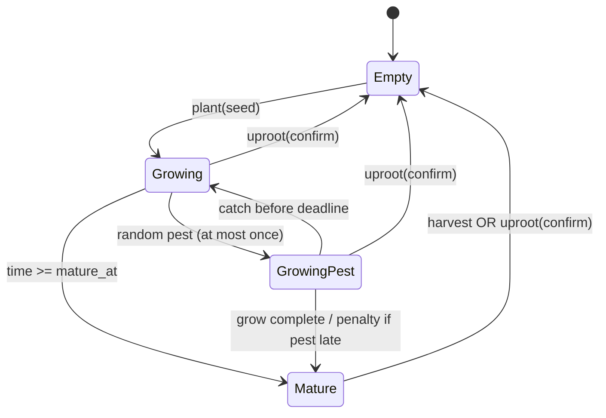

# 04 — Màn hình, trạng thái UI/UX và luồng thao tác

**Phân biệt:** Các luồng/chức năng đánh `[CHỐT]`, wireframe/chi tiết màu, kích thước và thứ tự UI là `[ĐỀ XUẤT]`. Không có tài nguyên đồ họa chính thức trong nguồn. AI khác phải tạo asset gốc hoặc xin asset được phép sử dụng.

## 1. Danh mục màn hình MVP

| ID | Màn hình | Nhiệm vụ | Trạng thái bắt buộc |
|---|---|---|---|
| UI-01 | Đăng ký | username/password, email tùy chọn | nhập, validate, chờ, thành công, trùng, rate limit, lỗi mạng |
| UI-02 | Đăng nhập | username/password, TOTP tùy chọn | loading, sai thông tin, bị ban, 2FA, session expired, retry |
| UI-03 | Tạo nhân vật | tên 3–16 grapheme, Unicode | available, invalid chars, duplicate, server reject, complete |
| UI-04 | Bản đồ chính | Phaser canvas + React HUD | connecting, connected, reconnecting, maintenance, server-down |
| UI-05 | Menu người chơi | Profile, Friends, Chat riêng | loading, online/offline, blocked, permission |
| UI-06 | Chat công cộng | tin trong phòng | gửi/nhận, pending, success, failed, spam limit, scroll |
| UI-07 | Chat riêng | lịch sử 50+20, seen/typing | loading/cursor, viewport read, block, expired, network failure |
| UI-08 | NPC cửa hàng | menu **trái**, nội dung **phải** | loading price-version, buy/sell result, bag full, insufficient funds |
| UI-09 | Túi đồ | 10 ô ban đầu, stack 999, 1 fashion/ô | item select, empty, full, upgrade, reject |
| UI-10 | Hàng chờ nông sản | merged crop pending | FIFO, claim, claim all, insufficient space, exceptional partial |
| UI-11 | Farm | 6 plot ban đầu, trồng/thu/nhổ/sâu | empty/growing/pest/mature, confirm uproot/Plant All |
| UI-12 | Thời trang | mua/mặc/tháo | equipped, not owned, conflict, room appearance sync |
| UI-13 | Nhiệm vụ ngày | tiến độ và claim | available, in progress, complete, claimed, day reset |
| UI-14 | Admin | login TOTP, RBAC, nội dung/điều chỉnh | forbidden, pending approval, approved, reject, audit |

## 2. Bố cục bản đồ [ĐỀ XUẤT]

- Canvas Phaser chiếm không gian trung tâm, camera theo nhân vật; React overlay chứa thông tin chính, nút mở cửa sổ.
- PC: WASD/arrows/click-to-path; mobile: **ngang**, joystick trái và chạm điểm đến; UI touch targets đủ lớn, không cản di chuyển.
- Bản đồ/phòng nhận `map_version`/`room_id`; Client không được tự gửi tọa độ cuối như “sự thật”.
- Không hiển thị icon mạng lên đầu nhân vật đang grace 30s (P0-009); có thể thông báo reconnect cho chính chủ ở HUD (đề xuất).

## 3. NPC — menu trái, nội dung phải [CHỐT]

```text
+---------------------------------------------------------+
| NPC [Tên]                          [Đóng]                |
+-----------------+---------------------------------------+
| Mua             | Danh sách/giá/vật phẩm theo tab       |
| Bán             | [Lọc] [Item] [Qty] [Giá] [Xác nhận]  |
| Hội thoại       |                                       |
| Các tab cấu hình| Trạng thái gửi và kết quả giao dịch    |
+-----------------+---------------------------------------+
```

- Click đổi tab **không đóng/mở lại** cửa sổ; menu trái và pane phải giữ nguyên trên mobile (tự co/scroll phù hợp).
- Giá có hiệu lực theo bản config bảo trì; nếu giá phiên Client lỗi thời, backend reject và yêu cầu tải lại; không âm thầm áp giá mới giữa 1 giao dịch đã được chốt.

## 4. Farm — state machine



- Khi người chơi offline hoặc bảo trì, trạng thái tính từ server timestamp; không dùng local timer làm nguồn thật.
- `Trồng tất cả`: cần confirm loại/số hạt. `Thu hoạch tất cả`: **không** confirm. `Nhổ tất cả`: confirm dù cây chín hay chưa.
- Đánh dấu plot theo ID để người chơi hiểu thứ tự thao tác batch.

## 5. Pending UI — nguyên tắc ưu tiên

- Hàng chờ nông sản: hiển thị cây, tổng số, thời gian sớm nhất, `Nhận`, `Nhận tất cả`. Nếu dòng không vừa: từ chối, không tự lấy một phần trừ ngoại lệ P0-083.
- Hàng chờ Kim Cương: hiển thị từng source/entry và FIFO, không gộp như nông sản.
- Luôn làm rõ `Đang xử lý` / `Thành công` / `Thất bại`; không hiển thị thành công ngay khi click trước ack từ Server.

## 6. Chat UI

- Chat công cộng theo phòng; cuộn/ẩn chat không làm mất dữ liệu server.
- Chat riêng: 50 tin đầu (cửa sổ mới nhất), khi cuộn gần đầu fetch 20 tin cũ và giữ vị trí; `seen` chỉ cho các tin thực sự hiện trong viewport.
- `Blocked`: thông báo gửi thất bại kiểu chung, không nêu “người kia đã chặn bạn”.
- Tìm block list theo tên bỏ dấu/hoa thường hoặc chính xác ID; 50 đầu +20 sau; mới chặn trước.

## 7. Accessibility / responsiveness [ĐỀ XUẤT]

- Font Unicode Việt, wrap text, form label rõ, keyboard focus, thông báo không phụ thuộc duy nhất màu.
- Desktop có hotkeys; mobile landscape duy trì menu trái NPC, dùng scroll trong khung thay vì đổi vị trí.
- Đoạn mạng yếu: tránh spinner vĩnh viễn, có retry và giữ `request_id`, không tự thao tác lặp gây nhân đôi.

## 8. Asset chưa có

Chưa có spritesheet nhân vật, tilesets, map Tiled sản phẩm, hình NPC, bản vẽ thời trang, animation, âm thanh, biểu tượng UI, typography, license. Chưa thể coi UI Ready-to-Ship. AI tạo asset phải cung cấp manifest `asset_id`, nguồn, quyền sử dụng, atlas frame, anchor, collider và màn kiểm duyệt chủ dự án.
