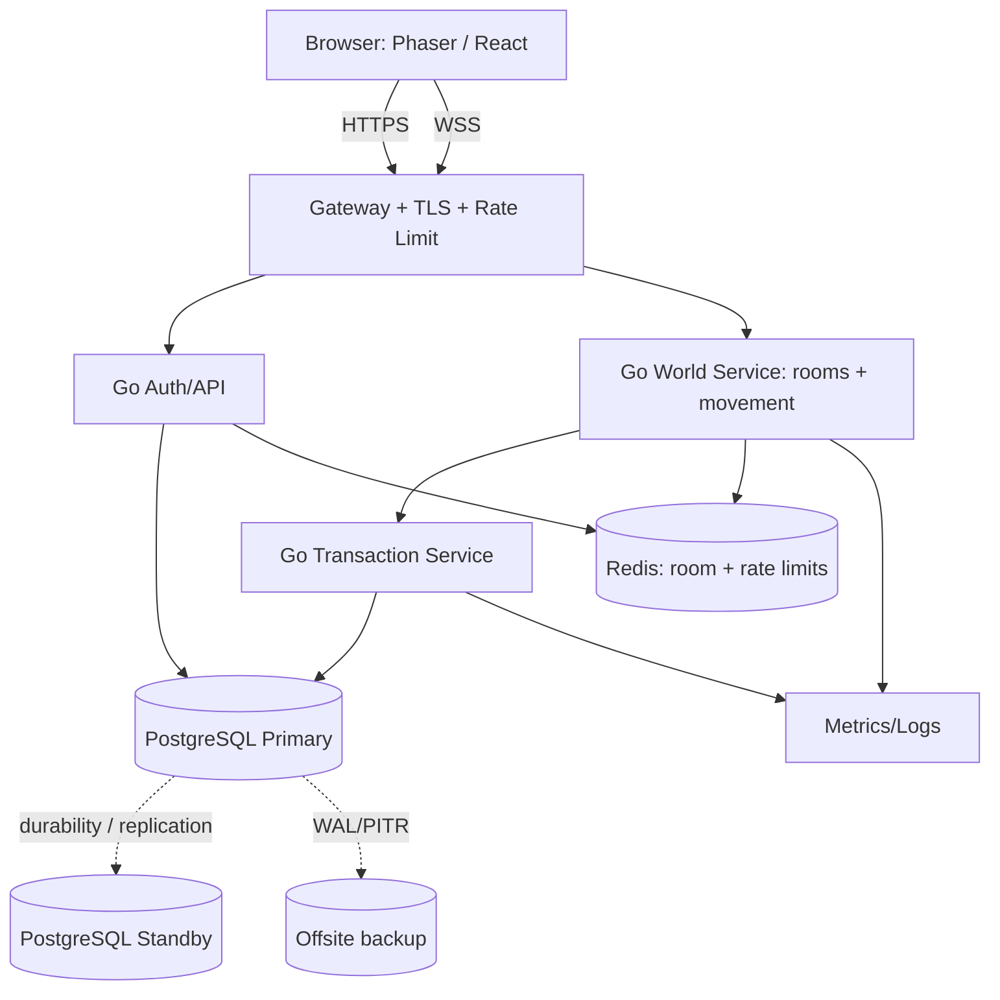

# 05 — Kiến trúc hệ thống, module, đồng bộ thời gian thực

## 1. Stack cố định [CHỐT]

- Client: **TypeScript + Phaser 2D + React**; web PC/mobile ngang.
- Game Server: **Go**, quản lý các phòng, chuyển động, người chơi trực tuyến, tương tác world.
- Transaction Service: **Go**, kiểm soát asset/ Xu/KC/ farm, atomic DB commits.
- PostgreSQL: account, character, inventory, economy, farm, quest, ledger, chat persistent.
- Redis: caching, rate-limit, presence/room registry/coordination; **không là canonical Xu/KC/item**.
- Tiled Map Editor: dữ liệu map JSON có collision sử dụng tương ứng trên Phaser/Go.
- Real-time: **WSS** với JSON cho message tần suất thấp, binary cho move/state snapshots.
- Monorepo GitHub `pqcuong99/Avatar`.

## 2. Sơ đồ components



**[ĐỀ XUẤT]** Có thể ban đầu dùng một Go codebase với package/service boundaries, sau đó tách process khi đạt đường găng. **[CHỐT]** Game Server không được sửa tài sản trực tiếp, trách nhiệm transaction tách riêng.

## 3. Go packages đề xuất

```text
game-server/
  cmd/world-server/
  internal/authn/          # verify cookie/token, version session
  internal/rooms/          # room allocation / transfer
  internal/movement/       # authoritative movement
  internal/mapdata/        # Tiled collisions + map version
  internal/realtime/       # JSON/binary codec + WS
  internal/presence/       # reconnect grace 30s
  internal/chat/           # public room chat gateway
transaction-service/
  cmd/transaction-service/
  internal/wallet/         # Xu, KC + ceilings
  internal/ledger/         # immutable transaction journal
  internal/inventory/      # slots and item instances
  internal/farm/           # plots, crops, pest, pending
  internal/npc/            # published price catalogs
  internal/quests/         # idempotent reward claim
  internal/idempotency/    # retry safe
  internal/storage/        # sql transaction and locks
client/src/
  game/                    # Phaser scenes + collision/pathing
  features/auth, farm, inventory, npc, chat, friends, fashion, quests
  network/                 # HTTP + WSS client
shared/                    # schemas generated from contracts, not Go structs directly
```

## 4. Movement [CHỐT behavior, ĐỀ XUẤT implementation]

- Local prediction from WASD/joystick or client A* pathfinding when click/touch. Manual override aborts path.
- Client gửi **input/direction/sequence**, không cập nhật canonical x/y theo ý mình.
- Go World Server kiểm tra speed limit, collision, map version, input timeline, room membership; vượt hợp lệ → reject/snap correction + log; nghi vấn lặp lại → Admin review, không tự ban.
- Người khác nhìn bằng interpolation; Client self-correct (reconciliation).
- Chỉ broadcast đến người trong room liên quan (interest management).
- **[CẦN TEST]** tick/snapshot update interval, delta encoding, bit packing, max payload, map scale; không chốt 20 Hz/30 Hz tùy tiện.

## 5. Rooms/reconnect/failover

- Room = (map_id, room_instance_id), `cap` do Admin cấu hình. Khi đầy tạo room khác, không UI chọn kênh.
- Profile người bạn -> `join-friend-room`: kiểm tra friendship + target session + capacity + map permission; chuyển atomically; nếu đầy báo lỗi, không vượt cap.
- Mất mạng 0–30s: vẫn chiếm 1 suất và hiện nhân vật đứng yên, session reconnect với token đủ điều kiện lấy lại phòng/vị trí.
- Quá 30s: giải phóng suất; reconnect muộn từ vị trí hợp lệ server persist và tự phân phòng.
- Một Game Server chết: cô lập instance, dùng state bền vững phục hồi phòng trên instance sống nếu có; không suy rằng RAM cũ có thể cứu được sau crash.
- **[CHỐT yêu cầu HA]** một server chết không kéo sập toàn game; PostgreSQL có dự phòng tự failover chỉ với leader hợp lệ, đồng bộ ghi an toàn. **[CHƯA TRIỂN KHAI]** vì hiện tại chỉ có 1 VPS cũ.

## 6. Transaction execution — canonical

```text
Client action(req_id, target, proposed_qty)
  -> Game Server verifies proximity/rights, derives server-side command
  -> Transaction Service (Go), verifies authenticated account/character
  -> BEGIN PostgreSQL transaction
  -> INSERT idempotency key (unique); if existing read prior result
  -> Lock wallet/inventory/farm/plot rows in consistent order
  -> Read active config version; validate prices, capacity, ownership
  -> Write all state changes; write immutable ledger entries + outbox
  -> COMMIT safely (per database durability policy)
  -> Return result and publish state.changed only after commit
```

- HTTP timeout/reconnect cannot imply rollback or success. If unknown outcome: query `request_id` outcome; do not send duplicate with new id.
- Monetary payment webhook idempotency is separate post-MVP, never generated from Client balance claims.
- For P0-150, if PostgreSQL cannot acknowledge required durable replica, **stop asset mutation** rather than tell players success.

## 7. Time and RNG

- `now()` ở Server (time stamps UTC). Plant `matures_at = planted_at + growth_seconds_snapshot`; login/restart reconstruct from DB timestamp.
- Random pest occurrence and penalty percent generate **once**, persist plan/event in durable storage; no re-roll on refresh.
- No per-crop in-memory timer as sole source of truth. For scheduled jobs, database state + idempotent worker can materialize overdue events (technical extension).

## 8. Docker/Local/production assumptions

- Local Windows developer Docker Desktop/WSL2 hiện đã chạy được demo UI/Go health according to user. Compose local + migrations from M1 patch need verification before use for data-bearing development.
- VPS Windows Server 2012 R2 **không thể dùng WSL2**; không giả vờ Docker Compose Linux chạy trực tiếp. Muốn Closed Beta ở máy cũ phải khảo sát runtime khả thi và rủi ro, hoặc có phương án host khác. Không khuyến nghị chạy hệ thống nhạy cảm trên OS hết hỗ trợ.
- Production/Open Beta: nhiều máy chủ/HA PostgreSQL/backup ngoài host, reverse proxy HTTPS/WSS, monitoring, graceful deploy + maintenance.
