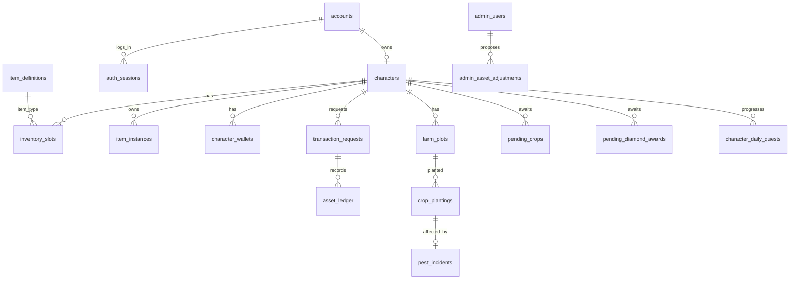

# 06 — Đặc tả cơ sở dữ liệu PostgreSQL

> **Bản schema đề xuất, không phải luật game đã được chủ dự án phê duyệt.** File SQL: `db/draft/0002_domain_PROPOSAL.sql`. File tham chiếu migration M1 thực tế: `reference/0001_auth_ACTUAL.sql`. Cần giữ/di chuyển tương thích với các bảng đã tồn tại; KHÔNG chạy draft bằng auto-migrate.

## 1. Nguyên tắc chuẩn hóa

- Primary keys UUID cho entity, key tự nhiên unique cho `item_code`, `crop_code`, `npc_code`, `quest_code`.
- `timestamptz` trong UTC; thời điểm ngày/giờ hiển thị được convert theo múi giờ; timezone reset nhiệm vụ chưa chốt.
- Số tiền tệ BIGINT nguyên, không float, không `REAL`.
- `config_version` bất biến sau publish; NPC price và crop config chỉ có hiệu lực sau bảo trì.
- Unique/cascade phải phản ánh 1 nhân vật/account và reset Beta.
- Ledger append-only bằng quyền DB/ứng dụng; chỉ người vận hành đặc quyền được thực thi lệnh Beta reset đã review.
- Trạng thái room/presence/position realtime quản lý Go+Redis; DB lưu vị trí hợp lệ cuối, không ghi mỗi frame.

## 2. Danh sách bảng theo domain

| Domain | Bảng đề xuất | Mục tiêu |
|---|---|---|
| Auth đã có M1 | `accounts`, `auth_sessions` | User, password_hash, login_generation, hashed token |
| Character | `characters`, `character_renames` | Một character/account, tên Unicode unique, lưu map/vị trí |
| Config | `game_config_versions`, `game_config_values` | Nội dung có version và publish qua bảo trì |
| Item/Inventory | `item_definitions`, `item_instances`, `inventory_slots`, `character_equipment` | Item catalog, fashion riêng instance, slot và trang bị |
| Money/Transactions | `character_wallets`, `transaction_requests`, `asset_ledger`, `outbox_events` | Balances, idempotency, sổ cái và phát event sau commit |
| Pending diamond | `pending_diamond_awards` | KC thưởng vượt cap theo từng nguồn, FIFO, no expiry |
| Farm | `crop_definitions`, `crop_config_versions`, `farm_plots`, `crop_plantings`, `pest_incidents`, `pending_crops` | Cây, plot, snapshot, sâu, crop pending gộp |
| NPC | `npc_definitions`, `npc_offers` | NPC vị trí và bảng giá versioned |
| Social | `friend_requests`, `friendships`, `private_chat_blocks`, `private_chat_messages`, `private_chat_seen`, `public_chat_messages` | Bạn bè, block, PM 30d, seen viewport, chat phòng |
| Quests | `quest_definitions`, `character_daily_quests` | Nhiệm vụ server-side, per-day claim once |
| Admin | `admin_users`, `admin_roles`, `admin_permissions`, `admin_user_roles`, `admin_role_permissions`, `admin_asset_adjustments`, `admin_audit_logs` | Tách player, 2FA, RBAC, dual approval, audit |

**Sau MVP:** các bảng chim, kho sâu, chợ P2P, payment webhook được lập migration mới, không lẫn vào MVP.

## 3. ERD logic

## 4. Account/Character & Unicode

- M1 `accounts`: đã có `username_key` ASCII tạm và `login_generation`. Không đổi trực tiếp tên bảng khi gắn patch.
- `characters.account_id UNIQUE` tạo bất biến 1 account đúng một nhân vật tối đa; frontend không được có thao tác delete/recreate.
- `characters.display_name_key UNIQUE`: tính Unicode normalization + casefold **không strip dấu**. DB không tự dùng `lower` collation để bảo đảm Unicode.
- Client xác minh nhanh, Server chuẩn hóa lại; kiểm tra grapheme bằng thư viện đúng chuẩn; khóa UNIQUE cuối cùng chặn cạnh tranh.
- Khi tạo nhân vật: transaction tạo character + plots + wallet 5.000 Xu, 0 KC + inventory 10 ô trống (có thể biểu diễn ô trống implicit, không cần 10 rows) + khởi tạo ledger ban đầu. Fail bất kỳ bước nào => rollback toàn bộ.

## 5. Inventory và item instance

- `inventory_slots` lưu **ô đang chứa item**, ô trống là thiếu row. `characters.inventory_slot_cap` quyết định slot no tối đa (ban đầu 10, upgrade +5).
- Stack item farm/upgrade/worm tối đa 999, định nghĩa catalog `stack_limit`; thời trang `stack_limit=1`, `item_instance_id` riêng; app transaction phải kiểm tra cross-table (SQL CHECK không thể tham chiếu `item_definitions`).
- `item_instances` giữ từng fashion item định danh riêng; `character_equipment` tham chiếu instance, đảm bảo `owner_character_id` khớp nhân vật, không dùng cùng item ở nhiều equip slots.
- **[CẦN XÁC MINH]** Item mặc có còn chiếm slot túi hay chuyển sang equip riêng; tài liệu chưa chốt, AI cần chọn mô hình sau khi xác minh UX. Bản schema đề xuất giữ item trong inventory khi trang bị, nhưng chưa thành luật.

## 6. Wallet, ledger và idempotency

**Canonical state:** `character_wallets(balance, cap, version)` và `inventory_slots`. Ledger `asset_ledger` giải thích mỗi thay đổi, **không tự động đảm bảo double-entry accountancy**; nếu cần sổ cái cân đối, nâng cấp thành model account debits/credits riêng sau review.

- Khoá số dư theo `(character_id,currency)` qua `SELECT ... FOR UPDATE` trong transaction; lock theo thứ tự ổn định để hạn chế deadlock.
- Mỗi command có `(character_id,request_id)` unique. Với request_id trùng + payload digest giống: trả đúng kết quả cũ; khác payload: `IDEMPOTENCY_CONFLICT`.
- Số dư sau cập nhật không âm và không vượt cap; mọi thay đổi phải ghi ledger trong cùng transaction.
- Nếu PostgreSQL failover/standby durability không đủ an toàn theo P0-150, không báo giao dịch thành công; đưa chế độ `ASSET_WRITES_DISABLED`.
- `transaction_requests.state='processing'` còn tồn tại khi timeout/crash => reconciliation dựa trạng thái thực tế trước retry; không tự retry bằng request_id mới.

## 7. Crop/pest/pending

- `crop_plantings` history giữ từng lần trồng, `state=growing` nghĩa **chưa thu/nhổ**, bao gồm cả đã trưởng thành theo timestamp; mỗi plot chỉ có một growing active (partial unique index).
- `growth_seconds_snapshot` và `base_yield_snapshot` là trị số tại lúc gieo; `config_version_id` truy vết.
- `pest_roll_completed` ghi rằng RNG đã được quyết định; `pest_incidents` tối đa một per planting, chứa spawn/deadline/penalty và caught; không re-roll sau restart.
- `pending_crops` unique `(character_id,crop_id)`, quantity merged, earliest timestamp FIFO; update 1 transaction lock, giữ `LEAST(old.earliest,new_timestamp)`.
- `pending_diamond_awards`: entry tách theo nguồn, FIFO bằng `(created_at,id)`, không có `expires_at`, không nhập vào pending_crops.

## 8. NPC và publish config

- `npc_offers` có `config_version_id`, server lấy bảng giá **published version** đã được triển khai qua bảo trì. Không update giá version đã publish.
- Giá seed trong `crop_config_versions` chỉ là một dòng config; nếu NPC bán seed có `npc_offers`, tránh hai nguồn giá không đồng bộ bằng quy ước canonical giá hàng bán ở `npc_offers` và crop seed price bản catalog chỉ để tham khảo hay phải kiểm chứng khớp.
- Vị trí NPC không trùng nhau/collider không cắt nhau là kiểm tra publishing tool, không thể bảo đảm bằng UNIQUE `(map_id,x,y)` cho collider có bán kính.

## 9. Chat / PII / retention

- Tin riêng có `expires_at = sent_at + 30 days`, cron purge hoặc query lọc ngay cả khi purge chạy trễ; indexes sender/recipient/time.
- Seen receipt chỉ ghi nhận khi viewport Client báo `visible`, nhưng Server cần validate viewer == recipient; tránh tin người gửi tự đánh seen.
- Block chat một chiều; danh sách tìm kiếm không dấu là **search feature khác** so với uniqueness của tên character (nơi dấu phải phân biệt). Dùng normalized search key riêng cho search; không sử dụng làm khóa duy nhất tên.
- **[CẦN ĐỐI CHIẾU]** chat public retention không có giá trị chốt; dự thảo schema lưu nhưng chưa quy định purge.

## 10. Admin / Beta reset

- `admin_users` **không FK vào accounts**, để reset player-data không làm mất Admin.
- Two-person adjustment: proposer_id != approver_id DB CHECK, đồng thời verify RBAC + TOTP + permission ở API; chỉ một transaction execution duy nhất.
- `admin_audit_logs` không chứa mật khẩu/mã TOTP/tokens; log hành động nhạy cảm đủ truy vết.
- Reset Closed Beta bằng **lệnh vận hành riêng**: lưu offsite backup, xác thực môi trường `closed_beta`, freeze write, đếm trước/sau, xóa player-owned tables theo FK rồi accounts, GIỮ admin/config; tránh `DROP DATABASE`/`docker compose down -v`. Cần test restore và được xác nhận nhiều lớp.

## 11. Migration và khôi phục

- Không sửa file migration đã áp dụng; thêm file `0003...`, có test upgrade trên DB mẫu với dữ liệu sẵn.
- Di chuyển/quản lý phiên bản schema bằng migration tool; archive migration hashes.
- Backup hằng ngày + WAL/PITR ra storage tách biệt (P0-139). Restore thử theo kịch bản giao dịch NPC thu hoạch và đối soát ledger.
- PostgreSQL Primary + synchronous eligible Standby trước Open Beta; tránh split-brain, hiển thị asset operation unavailable nếu không bảo đảm data durability.

## 12. Đánh giá thiết kế SQL trước khi thực thi

Các điểm **SQL draft không tự enforce hoàn toàn**: Unicode grapheme, item stack limit từ catalog, số ô túi nâng cấp, owner instance tương ứng equip, 100 friends, NPC collision, timeout event sâu, hạn mức farm plot Admin, giá cấu hình đã publish, hai người đều có quyền phê duyệt, không cho sửa ledger thông thường. Bắt buộc enforce bằng transaction/business layer + tests, và bổ sung trigger/DB roles nếu phù hợp.
